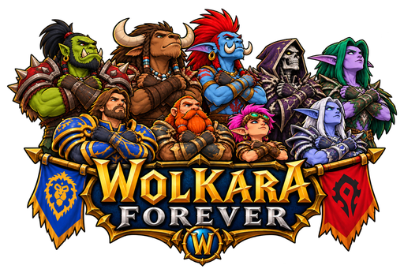

<p align="center"></p>

# WolkaraForever

> Verified: 2026-11-21 · Source: `8375cbb`

Run World of Warcraft Forever locally on an iPad or iPhone with a source-built WolkaraForever installation. The app downloads and maintains your game data, then starts the unchanged client through Tolkara. It is not a streaming service and does not include game files.

## Before you begin

You need an Apple-silicon Mac, current Xcode and command-line tools, XcodeGen, Python 3, a paid Apple Developer membership, and an unlocked device in Developer Mode. Reserve about 70 GB for Forever. An Intel Mac runs the same commands and is warned about, not refused, but the documented path and the device builds are arm64.

## Install from source

```sh
git clone https://github.com/jklock/wolkaraforever.git
cd wolkaraforever
cp local.env.example local.env
wolkaraforever/tools/install_prerequisites.sh --check
wolkaraforever/tools/device_variables.sh --write
wolkaraforever/tools/preflight.sh
wolkaraforever/tools/install.sh
```

Read [Install WolkaraForever](docs/INSTALLATION.md) before you begin, and
[Build and run WolkaraForever](docs/BUILDING.md) for the execution modes, the simulator runs, and
the unsigned External JIT package. If you would rather sideload a package than build the app,
[Install the unsigned External JIT app](docs/SIDELOADING.md) is that route.

## What you can do

- Download, resume, repair, update, and start a selected Forever client.
- Choose game and app languages independently.
- Choose an iPadOS or iOS on Duo interface.
- Manage supported add-ons and recover your interface safely.
- Use touch, keyboard, controller, and optional dictation input.
- Cap the frame rate and dim an idle session with Battery Saver, and keep the game's sound without
  loading iOS's audio device layer into it.
- Keep one game password on the device, behind Face ID, for the opt-in experimental Battle.net
  login.

Read [Use WolkaraForever](docs/USING_WOLKARAFOREVER.md) and [iPhone use](docs/IPHONE.md) for procedures.
When something breaks, [Send us a log](docs/SENDING_LOGS.md) — it takes a few taps on the
iPad and needs no computer.

## Safety and support

No mode patches, re-signs, or redistributes game code. WolkaraForever does not automate gameplay, bypass integrity checks, or inspect a running game beyond loading and verification. Read [Compatibility](COMPATIBILITY.md) for support limits and [Security](SECURITY.md) to report a vulnerability.

## Thank you

Thank you to everyone who has opened a pull request, reported a problem, reviewed a change, or
contributed to Wolkara, Tolkara, and WolkaraForever. Project attribution is maintained in
[Contributors](CONTRIBUTORS.md).
