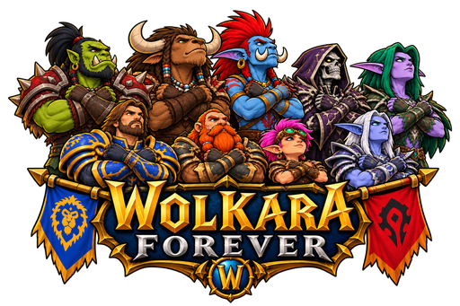

<p align="center"></p>

# WolkaraForever

> Verified: 2026-11-13 · Source: `3c33543`

Run World of Warcraft Forever locally on an iPad or iPhone with a source-built WolkaraForever installation. The app downloads and maintains your game data, then starts the unchanged client through Tolkara. It is not a streaming service and does not include game files.

## Before you begin

You need an Apple-silicon Mac, current Xcode and command-line tools, XcodeGen, Python 3, a paid Apple Developer membership, and an unlocked device in Developer Mode. Reserve about 70 GB for Forever.

## Install from source

```sh
git clone https://github.com/jklock/wolkaraforever.git
cd wolkaraforever
cp local.env.example local.env
wolkaraforever/tools/install_prerequisites.sh --check
wolkaraforever/tools/device_variables.sh --write
wolkaraforever/tools/preflight.sh
wolkaraforever/tools/install.sh
```

Read [Install WolkaraForever](docs/INSTALLATION.md) before you begin.

## What you can do

- Download, resume, repair, update, and start a selected Forever client.
- Choose game and app languages independently.
- Choose an iPadOS or iOS on Duo interface.
- Manage supported add-ons and recover your interface safely.
- Use touch, keyboard, controller, and optional dictation input.

Read [Use WolkaraForever](docs/USING_WOLKARAFOREVER.md) and [iPhone use](docs/IPHONE.md) for procedures.

## Safety and support

No mode patches, re-signs, or redistributes game code. WolkaraForever does not automate gameplay, bypass integrity checks, or inspect a running game beyond loading and verification. Read [Compatibility](COMPATIBILITY.md) for support limits and [Security](SECURITY.md) to report a vulnerability.
