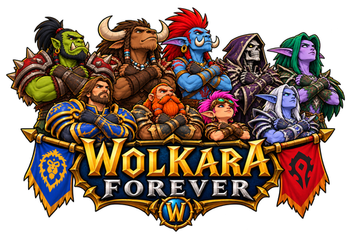

<p align="center">
  
</p>

<h1 align="center">WolkaraForever</h1>

<p align="center"><strong>World of Warcraft Forever on iPhone and iPad, built on <a href="https://github.com/tolkara/tolkara">Tolkara</a>.</strong></p>

WolkaraForever is the name of this fork, its repository and everything in it. The Xcode scheme
and product still say **Tolkara**, because that project is the upstream platform this fork is
built on; only the display name and this fork's own files carry the fork's name. The bundle ID
and Keychain group are yours to set in `local.env`, and keeping them is what makes an update
replace the app in place.

WolkaraForever is an independent, experimental fork focused on the WoW experience:
choose an edition, download its macOS client on the device, keep it updated,
and play with touch controls or a physical controller. The game runs locally
through Tolkara's compatibility layer; it is not streamed from a Mac.

Tolkara's runtime and macOS API translation are the foundation of this project.
WolkaraForever adds the WoW launcher, the downloader and updater, the add-on
manager and the mobile input layer.
The upstream history, MIT license and [third-party notices](NOTICE.md) are retained.
This project is not affiliated with or endorsed by Blizzard Entertainment.

## What you need

- An Apple silicon Mac with Xcode (and its requested platform components), XcodeGen
  (`brew install xcodegen`) and Python 3.
- Your own Apple developer signing with a paid membership: the app and its tunnel need
  the Network Extension, increased-memory-limit and extended-address-space capabilities,
  which free Personal Team signing cannot provide.
- An iPhone or iPad with Developer Mode enabled, trusted by the Mac, and enough free
  storage for the edition - the tested Forever install is roughly 70 GB.
- Your own eligible game account/access. Game files come from Blizzard's CDN; no game
  code or assets are included here, and WoW/Battle.net need not be on the Mac.

This is a source release for people comfortable with Xcode. There is no tested public
WolkaraForever IPA, App Store/TestFlight release or AltStore PAL install path, and a
successful build alone does not prove a signing profile permits startup.

## Quick start

1. **Clone and configure.**

   ```bash
   git clone https://github.com/fJavierLasso/wolkaraforever.git
   cd wolkaraforever
   cp local.env.example local.env
   ```

   Fill in `DEVELOPMENT_TEAM`, `TOLKARA_BUNDLE_ID`, `TOLKARA_KEYCHAIN_GROUP` and
   `DEVICE` (from `xcrun devicectl list devices`). Keep them local; do not commit them.

2. **Build, install and enroll in one step.**

   ```bash
   wolkaraforever/tools/install.sh
   ```

   This prepares the tree, builds and signs our code, installs the app, runs the
   Developer-service enrollment, and relaunches the launcher to prove it reached home.
   `--build-only` stops after the build.

   Prefer Xcode? Run `wolkaraforever/tools/generate.sh`, open
   `build/platform/Tolkara.xcodeproj`, pick the **Tolkara** scheme and your device, then
   Run. Afterwards enroll once with `cd build/platform && tools/enroll.sh` and approve
   the pairing prompt. The app installed on the device is called **WolkaraForever**.

3. **Install an edition and play.** Choose **Forever - Beta**, your region and language,
   then **Install**. Keep the app in the foreground while it downloads; it checks for
   updates on open and before launch. After **Ready to play**, press **Play**, allow the
   local tunnel if iOS asks, and let memory preparation finish. Log in with your own
   account.

Memory preparation takes several minutes on each launch on the current engine; keep the
app in the foreground during it. The full first-download flow is still being validated
on-device - see the [fresh-install checklist](docs/FRESH_INSTALL_TEST.md).

## Everyday use

- **Updates** happen inside the app: it checks on open and before launch, installs
  required updates before enabling Play, resumes interrupted downloads, verifies them by
  checksum, and reuses unchanged verified data. Game data and add-ons survive updates.
- **Add-ons**: import an archive from the Files app or from CurseForge. The manager
  handles duplicates, disable/restore, pin and remove, and never deletes a folder it did
  not create.
- **Touch and dictation**: an on-screen toolbar opens a keyboard with dictation, a
  trackpad with two-finger scrolling, and a draft that replaces the focused game field.
  A mapped button starts and stops dictation; the transcript is typed into the focused
  field, with Return only when auto-submit is on.
- **Controller**: a physical pad is supported, and an on-screen controller appears when
  none is connected. Both have opacity, size, layout and haptics settings.
- **Leave game**: the on-screen toolbar's **Leave game** closes the app after a
  five-second countdown, so a screen with no quit (the login screen, say) is not a dead
  end. The next launch has Play working again.
- **Recovery**: Settings -> Technical details and the in-app log are the first stop for
  any failure. Do not delete the app or its data as a first step.

## Three execution modes

How the original executable reaches memory, chosen by the user:

| Mode | How it prepares memory | What is signed |
| --- | --- | --- |
| **Developer service** | The iPad's own developer service, reached over the app's tunnel extension; the debugger detaches before any application code runs. | Only our code. |
| **External JIT** | A JIT enabler (your sideloading tool, or StikDebug) attaches at launch; the runtime asks it to detach and refuses entry while anything is attached. | Only our code; the app is unsigned and your tool signs it. |
| **Local signing** | A page container derived from the application's final code pages, signed with your own identity. | The container; application code is never re-signed. |

WolkaraForever uses **Developer service** in its integrated build. See
[advanced build and execution modes](docs/BUILDING.md) for each route.

## Features

- A single home screen for the WoW client: edition, region and language.
- On-device installation and automatic update checks; a required update finishes
  before Play becomes available. Downloads resume, are checksum-verified, and
  verified unchanged game data is reused rather than fetched again. Updates keep
  the user's settings and add-ons.
- An add-on manager: import an archive from the Files app or from CurseForge,
  with duplicate, disable, restore, pin and remove handled by the app, and a
  manifest that records what it installed, so it never removes a folder it did
  not create.
- An iOS keyboard with dictation and an editable draft that replaces the focused
  game field, plus a touch trackpad with two-finger scrolling. A mapped button
  starts and stops dictation, in either Hold to talk or Press to start and stop,
  and - for a keyboard key - the game can be kept from seeing it at all. The
  transcript is typed into whatever field the game has focused, with Return only
  when auto-submit is on.
- Physical controller support and an on-screen controller when none is connected,
  with an inspector that reports what a pad has and what it does.
- A **Leave game** button on the on-screen toolbar, so a game screen with no quit
  of its own - the login screen is one - is not a dead end. It closes WolkaraForever
  after a five-second countdown page that says what to do next; the next launch
  has Play working again.
- Movable touch controls, opacity and size settings, an alignment grid and haptics.
- The licences the app is obliged to ship, composed into About and reported in
  the app's own log.
## What has been tested

The short version of how to read the rest of this section: every claim here has a script behind
it, and the script's own output is what is quoted. `wolkaraforever/tools/validate.sh` runs the whole
set - the layer gate, the unit and fixture suites, the device build, the install and launch on
the iPad, and the device matrix - and writes a per-commit record under
`development/validation/`, naming the commit it was measured against.

The device matrix is 23 checks and includes the app's own self-tests, which the app runs on
itself when launched with `--selftest=<name>`: `input` drives the real input router, settings
store and published key set with synthetic presses; `voice` opens a real dictation session
with the real recogniser - on-device only - and checks that the session is handed back; and
`dictation-target` asks the object registered as the game's text input whether it takes words
and keys. They do not prove the microphone delivered audio or that a person spoke: what they
assert is the session state and the wiring. Those exist because a script cannot press a pad
button or speak; a person is only needed for a real voice, a real pad and the game itself.
Voice dictation was extensively validated by the user on the physical iPad on 2026-10-21, both
on the home screen's **Test Voice** page and inside the running game. Device logs hold the
recorded evidence for the exercised paths (see [`docs/VOICE.md`](docs/VOICE.md#verified-on-the-device)).
Development and testing automation is welcome here: the
ban in the policy below is on automating *the game*, not on testing this app.

The developer reports **60 FPS at graphics quality 4 on an iPhone 16 Pro Max**
playing WoW Forever (Classic beta). This is a gameplay report, not a benchmark
or a promise for every scene/device. Render scale was not specified in this
latest report; the earlier quality-2 session used 50% render scale.

Forever login, gameplay and the touch controls have been tested on that phone.
Classic Era reached its cinematic and login screen. A Mac-disconnected launch,
including after reboot, has also been reported with the existing authorization.
The edition selector includes other WoW clients; their presence is not a
compatibility claim. See [COMPATIBILITY.md](COMPATIBILITY.md) for dated results.

The updater has synthetic regression coverage, isolated Mac-copy tests and a
recorded device patch installations. Xcode logs also confirm that the latest
metadata-recovery fix completed an on-device update. A complete first download
into an empty iPhone installation still needs end-to-end validation. Follow the [fresh-install checklist](docs/FRESH_INSTALL_TEST.md)
and report the exact commit and client build you tried.

## Current limits

- Setup is still a developer workflow, with personal signing and enrollment.
- Executable-memory preparation still takes several minutes on each launch.
  Keep the app in the foreground during this step.
- Cellular-only startup has an unresolved report; a disconnected Mac does not
  establish that every mobile-network condition works.
- Other devices, editions and signing methods need testing. Voice chat's
  separate helper process is not supported.
- Keyboard/input and update recovery are actively being improved. If something
  fails, include the exact message from Settings → Technical details and a
  redacted log, never account or pairing information.

## Development

```bash
wolkaraforever/tools/test_emulation.sh
```

That runs the layer gate, the platform suite against the prepared tree, and every layer
suite. Focused updater tests: `wolkaraforever/tools/test_wow_launcher.sh`. UIKit fixtures:
`wolkaraforever/tools/test_wow_launcher_ui.sh` (set `SIMULATOR` to an available simulator).
Read [CONTRIBUTING.md](CONTRIBUTING.md) before contributing, and
[TESTING.md](docs/TESTING.md) for what each suite proves and how evidence is recorded.

- [All documentation](docs/README.md) - the full index
- [Testing](docs/TESTING.md) and [tools reference](docs/TOOLING.md)
- [Launcher and updater](docs/WOW_LAUNCHER.md)
- [Touch input](docs/TOUCH_INPUT.md)
- [Touch controller](docs/TOUCH_CONTROLLER_PROPOSAL.md)
- [Engine architecture](docs/ARCHITECTURE.md)
- [Advanced build and execution modes](docs/BUILDING.md)
- [Distribution research and unverified routes](docs/WOLKARAFOREVER_DISTRIBUTION.md)

The shared engine, adapters and non-WoW test fixtures remain in this fork to
preserve upstream compatibility and regression coverage. Public WolkaraForever builds
use the WoW home; alternative loaders/modes are development tools.

## What Tolkara does to the application

So that you can judge this yourself rather than take our word for it:

- The original executable is imported as a file, verified by SHA-256, and mapped
  into memory. It is never edited, re-signed, or included in the app bundle. The
  loader applies the same rebases and binds dyld would; those are runtime state
  in memory, not changes to the file. With Local signing, a copy of its final
  code pages is signed with your identity in a separate page container that
  stays on your Mac and your iPad.
- The loader answers a short, fixed list of calls itself instead of passing them
  to iPadOS, because they concern how the image was loaded: `mmap`, `mprotect`,
  `munmap`, `memcpy`, `memmove`, `memset`, `__clear_cache` (for the separate
  read-write and executable views of code memory), `pthread_jit_write_protect_np`, `dladdr`,
  `dlsym`, `_NSGetExecutablePath`, `CFBundleGetMainBundle`, `_tlv_bootstrap`,
  `dyld_stub_binder`, `__ulock_wait` and `sigaction` (the last only when you
  opt into crash logging). The list is in
  [`platform/runtime/NativeGuest.m`](platform/runtime/NativeGuest.m).
- Everything else the application imports resolves to the real iPadOS framework,
  to a translation library in [`platform/translation/`](platform/translation), or to a library the
  application carries in its own bundle. An import that nothing provides
  becomes a stub that logs and returns zero: generated at build time for the
  executable of a build made for it, and made at launch in a generic build (made
  for no particular application) and for the libraries an application carries.
  In a build made for one application, an import of its executable that nothing
  provides at launch stops the launch instead.
- Nothing in Tolkara exists to hide the environment from the application. It does
  not conceal debuggers, processes, the device model or the operating system.
  With Developer service, the debugger used to prepare memory detaches before
  the first application instruction runs, and nothing attaches afterwards.
  With External JIT, Tolkara asks the enabler's debugger to detach and does not
  start the application while any debugger is attached. Local signing uses no
  debugger.

## Policy

WolkaraForever builds on Tolkara as a compatibility layer. This fork will not accept:

- reading or changing an application's memory for any purpose other than
  loading it, including "trainers", overlays, bots or input automation;
- workarounds for anti-cheat, licence or integrity checks;
- redistribution of third-party application code, assets or operating-system
  components in this repository or its releases. The updater obtains game
  content directly from the vendor for the user's installation.

## Online games

WolkaraForever is not approved or supported by Blizzard. Successful execution does not
establish publisher approval or guarantee the safety of an online account.
The project provides no anti-cheat, license or integrity-check workarounds.

## Legal

WolkaraForever and the upstream Tolkara code are released under the [MIT License](LICENSE).
No game files or Apple operating-system components are included. Third-party
adaptations and reference material are credited in [NOTICE.md](NOTICE.md).

WolkaraForever is an independent project and is not affiliated with, sponsored by or
endorsed by Apple Inc. or Blizzard Entertainment, Inc. macOS, iPadOS, iPad,
Metal and Xcode are trademarks of Apple Inc. World of Warcraft and Blizzard are
trademarks of Blizzard Entertainment, Inc. Other names are the property of their
owners and are used only to describe compatibility.

You are responsible for having the right to use any application you run with
WolkaraForever, and for complying with its licence.

WolkaraForever: [source and issues](https://github.com/fJavierLasso/wolkaraforever).
Upstream engine: [Tolkara](https://github.com/tolkara/tolkara) · [tolkara.org](https://tolkara.org).
