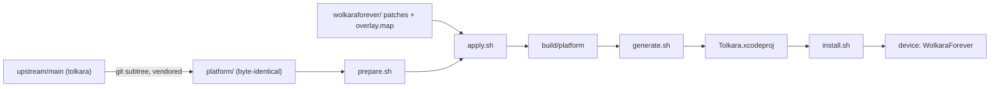
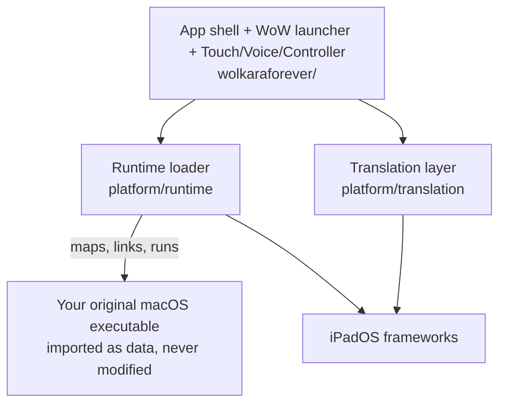
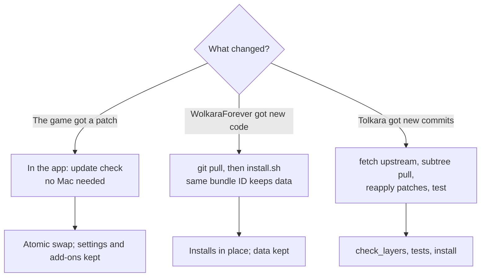
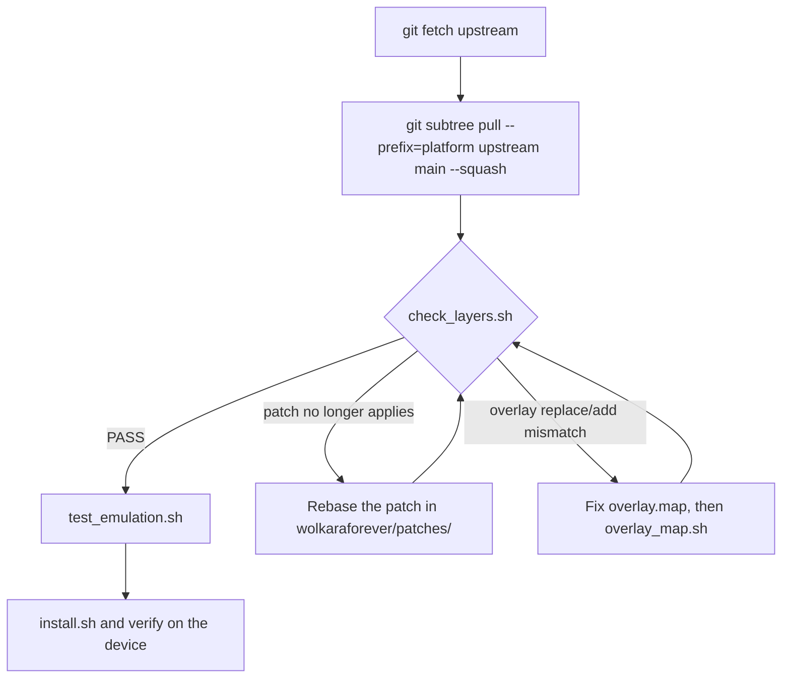

# Maintaining WolkaraForever

This page explains how WolkaraForever sits on top of the Tolkara engine, and the safe way to
update each of the three things that can change: the **engine (Tolkara)**, the
**WolkaraForever app**, and the **game data**. The short rule for all three: never edit or
delete by hand what a script updates for you, and always keep the same bundle ID.

- Setting up from nothing for the first time: [FROM_ZERO.md](FROM_ZERO.md).
- What each suite proves: [TESTING.md](TESTING.md).
- What every script does: [TOOLING.md](TOOLING.md).

---

## How it lives on top of Tolkara

There are three layers. Only the middle one is ours.

| Layer | What it is | Where it lives | Editable by hand? |
| --- | --- | --- | --- |
| **Engine** | Upstream Tolkara: the Mach-O loader, the macOS API translation, the developer-service authorization. | `platform/`, the most current Tolkara (`upstream/main`), vendored byte-identical. | **No.** Never. |
| **Our layer** | Patches to engine files, plus our own modules (WoW launcher, touch, voice, controller, shell). | `wolkaraforever/patches/` and `wolkaraforever/overlay.map`. | Yes, that is the point. |
| **The app** | The built, signed Xcode project. | `build/platform/Tolkara.xcodeproj`, generated. | No; regenerate it. |

WolkaraForever does not change how Tolkara works. The loader, authorization and execution
behaviour are upstream's, and how Tolkara does things is how WolkaraForever does them; the
layer adds the WoW app and input, not a different execution model.

### How the build is assembled



`prepare.sh` exports a pristine copy of `platform/` into `build/platform/`, applies every patch
in `wolkaraforever/patches/`, then copies our files in at the paths named by
`wolkaraforever/overlay.map`. A patch that no longer applies, or an overlay entry that no longer
matches, stops the run. `check_layers.sh` is the gate that proves all of that, and that no one
edited `platform/`.

### What runs on the device



Your original executable is imported as data and verified by SHA-256; it is never patched or
re-signed into the app. The runtime maps it, the translation layer answers the macOS calls it
makes with iPadOS or with our adapters, and our shell provides the WoW home screen, updater and
input.

### Where everything lives

| Path | Contents | Safe to delete? |
| --- | --- | --- |
| `platform/` | Vendored engine. | No. |
| `wolkaraforever/patches/` | Our changes to engine files. | No. |
| `wolkaraforever/overlay.map` | Which of our files goes where. | No; regenerate with `overlay_map.sh`. |
| `wolkaraforever/` modules | Our own code (`WoW/`, `Touch/`, `Voice/`, `Controller/`, `Shell/`, `Bridge/`). | No. |
| `build/`, `logs/` | Ignored build output. | Yes, any time. |
| Device Documents | Game files, add-ons, settings, logs. | **Never by uninstalling.** |

## The three things you can update



Pick the row that matches what changed. Do not mix them: updating the engine does not update
the game, and updating the game does not update the app.

---

## Updating WolkaraForever (the app)

Use this when the fork's own code changes (a new launcher feature, an input fix).

1. Close the game.
2. Get the new source and confirm the layer is sound:

   ```bash
   git pull
   wolkaraforever/tools/check_layers.sh
   wolkaraforever/tools/test_emulation.sh
   ```

3. Build and install over the existing app:

   ```bash
   wolkaraforever/tools/install.sh
   ```

The install replaces the app **in place** because the bundle ID and Keychain group are
unchanged, so the game files, add-ons, saved layout and log survive. Re-running
`generate.sh` is only needed on the manual Xcode route.

> **Do not uninstall to update.** Uninstalling deletes the game files, the enrollment and any
> page container. Installing over keeps them.

## Updating Tolkara (the engine)

WolkaraForever uses the most current pull of Tolkara. The engine is a git subtree at
`platform/` and is never edited by hand; to move to newer Tolkara you pull it, and our patches
are re-applied on top.

### One command

```bash
wolkaraforever/tools/update_tolkara.sh            # fetch, pull, and run the gate
wolkaraforever/tools/update_tolkara.sh --check    # is platform/ current, and what changed
wolkaraforever/tools/update_tolkara.sh --test     # ... then run the suites
wolkaraforever/tools/update_tolkara.sh --install  # ... then build and install
```

It refuses a dirty worktree unless you pass `--allow-dirty`, because a subtree pull makes a
commit and your other uncommitted edits could conflict. If the gate fails after the pull, the
script stops and names the patch or overlay entry to fix; the engine is never edited by hand to
make a patch fit.



### The same steps by hand

```bash
# 1. See what upstream has.
git fetch upstream
git --no-pager log --oneline -20 upstream/main

# 2. Vendor the new engine into platform/ (this is how it was added: --squash).
git subtree pull --prefix=platform upstream main --squash

# 3. Prove the layer still fits.
wolkaraforever/tools/check_layers.sh

# 4. Only if check_layers passes: run the suites, then install.
wolkaraforever/tools/test_emulation.sh
wolkaraforever/tools/install.sh
```

### What the gate is checking

`check_layers.sh` compares `HEAD:platform` to your local `upstream/main` tree. That is why
`git fetch upstream` alone makes it fail: you have the new ref but have not vendored it yet.
Pull (step 2), and it should pass again. It also proves:

- nothing under `platform/` mentions WolkaraForever (the engine stays brand-free and
  upstream-acceptable);
- every patch in `wolkaraforever/patches/` applies to the new engine;
- every `overlay.map` entry still finds (or, for an addition, does not collide with) its
  engine file;
- no module reaches into another's internals.

### When something breaks, and how to fix it

| `check_layers.sh` says | What happened | Fix |
| --- | --- | --- |
| `platform/ differs from upstream/main` | You fetched but did not pull, or `platform/` was hand-edited. | Do the subtree pull. If it was hand-edited, revert that edit - the engine is never edited by hand. |
| `NNNN-....patch does not apply` | Upstream changed a file our patch touches. | Update the patch's hunks to the new file, keeping its intent. Apply it in a scratch copy of the new `platform/`, resolve, then re-diff into the same patch file. Re-run the gate. |
| `applied but changed nothing` | The patch was silently skipped (often a path resolved against the wrong tree). | Regenerate the patch so it applies for real, then re-check. |
| a layer file is not in the overlay | A new file was added without updating the map. | `wolkaraforever/tools/overlay_map.sh`, then re-run the gate. |
| an overlay `add` collides, or a `replace` target is missing | Upstream added a file we add, or moved one we replace. | Rename/move our file or change the map entry; re-run `overlay_map.sh` and the gate. |

Only after the gate passes should you run the suites and install. If a test now fails, the
engine change is the suspect, not the game.

> **Rolling back an engine update.** The subtree pull is a commit. Right after it,
> `git reset --hard HEAD^` goes back one step; later, `git revert -m 1 <merge>` undoes it.
> Re-run `check_layers.sh` and install again. The app data on the device is untouched.

## Updating the game

The game is updated by the app itself. No Mac is needed, and the engine does not take part.

1. Open WolkaraForever. It checks for updates on open, on returning to the foreground, and
   again before **Play**.
2. An outdated install updates automatically; a missing edition offers **Install**; an
   unverifiable one offers **Repair**.
3. Keep the app in the foreground while it downloads. Backgrounding cancels the current
   transfer, but verified objects are kept and reused, so reopening resumes rather than
   restarts.
4. **Play** stays disabled until the current published build and its original executable pass
   verification. That is deliberate: a failed check never counts as up to date.

What the updater guarantees, so you do not need to:

- it never patches or re-signs the game's executable;
- it writes into a private APFS clone and activates the whole installation with one atomic
  directory swap, so an interrupted update leaves the working install in place;
- it preserves `WTF` (your settings) and `Interface` (your add-ons) across the switch;
- verified, unchanged content is reused rather than downloaded again.

If something looks wrong, use **Settings -> Verify and repair game files**, which forces a full
payload check even when the build looks current. Do not hand-edit game files, and do not
delete the app.

> **Local signing only: rebuild the page container after a game update.** A page container is
> bound to the executable's code pages. A new executable makes the old container invalid, and
> the runtime refuses to start. Rebuild it (see [BUILDING.md](BUILDING.md#local-signing-build-the-page-container))
> and copy it to the device; Developer service and External JIT have no equivalent step.

If a new game format ever needs engine work, update WolkaraForever (the app) to a build that
supports it. Do not try to make an old app accept a new format by editing files.

---

## Golden rules

1. **Never edit `platform/`.** Every change to engine behavior is a patch in
   `wolkaraforever/patches/`; every new file is mapped in `wolkaraforever/overlay.map`.
2. **Never uninstall to fix something.** Deleting the app deletes the game, the enrollment and
   any page container. Install over it instead.
3. **Keep the bundle ID and Keychain group stable.** They are what make an update replace the
   app in place and keep its data.
4. **Keep the app in the foreground** while downloading, updating or preparing memory.
5. **One game session per process.** When the game closes, reopen WolkaraForever.
6. **Never attach a debugger after guest entry.** The runtime deliberately detaches first.
7. **Keep secrets local.** `local.env`, pairing records, profiles, containers and captures never
   go in a commit or a log.
8. **Run the gate before you trust a build.** `check_layers.sh`, then `test_emulation.sh`, then
   install.

## Backups and rollback

| To roll back... | Do this | Data kept? |
| --- | --- | --- |
| the app | check out the previous commit, `wolkaraforever/tools/install.sh` | Yes (game, add-ons, settings). |
| the engine | revert or reset the subtree commit, `check_layers.sh`, install | Yes. |
| a bad game update | **Settings -> Verify and repair game files**; do not delete the app | Yes. |
| the whole device | an iOS/iPadOS backup, or copy the app's Documents with the Files app | Depends on the backup. |

## Maintenance cadence

A light routine that keeps things healthy:

- **Before any update:** close the game; confirm the app is at the home screen, not mid-update;
  check free space; use a stable network.
- **When upstream Tolkara moves:** follow [Updating Tolkara](#updating-tolkara-the-engine),
  and let the gate and suites decide - do not install on a failed gate.
- **When the fork's code moves:** [Updating WolkaraForever](#updating-wolkaraforever-the-app).
- **After installing:** reopen to home, run a session, and record the result in
  [COMPATIBILITY.md](../COMPATIBILITY.md) with the date and device.
- **Periodically:** `wolkaraforever/tools/test_emulation.sh` and
  `wolkaraforever/tools/device_matrix.sh`; `wolkaraforever/tools/check_docs.sh` to keep the docs
  honest.
