# What every control does

> Verified: 2026-11-21 · Source: `8375cbb`

This page is the reference for the launcher: every row, switch, button and sheet, what it does, and
how to use it. The task-by-task instructions are in [Use WolkaraForever](USING_WOLKARAFOREVER.md);
this page is the list you check when you want to know what one control is for.

The pictures are drawn by the project's own launcher fixture on the matrix iPad Pro 13-inch (M5),
so they show the shipped layout and text. The fixture is a synthetic installation: it has no game
and no account, which is why the pictures show a demo version, no add-ons, and "this device
(unrecognised)" where your own iPad would name its model. Two surfaces have no picture here
because they only exist while a game is running — the
[in-game toolbar and touch settings](#in-game-toolbar-and-touch-settings) — and they are described
in words instead.

A control that changes also changes its picture and this page; the build-and-test side of that is
in the contributor documentation, not here.

## Contents

1. [Home page](#home-page)
2. [Settings sheet](#settings-sheet)
3. [About](#about)
4. [Game Edition](#game-edition)
5. [Region and game language](#region-and-game-language)
6. [App language](#app-language)
7. [Battery Saver](#battery-saver)
8. [Device profile](#device-profile)
9. [Render profile](#render-profile)
10. [Interface Mode](#interface-mode)
11. [Controller Layout](#controller-layout)
12. [Add-On Manager](#add-on-manager)
13. [Key / Controller Button Configuration](#key-controller-button-configuration)
14. [Controller Touchpad Configuration](#controller-touchpad-configuration)
15. [In-game toolbar and touch settings](#in-game-toolbar-and-touch-settings)

## Home page

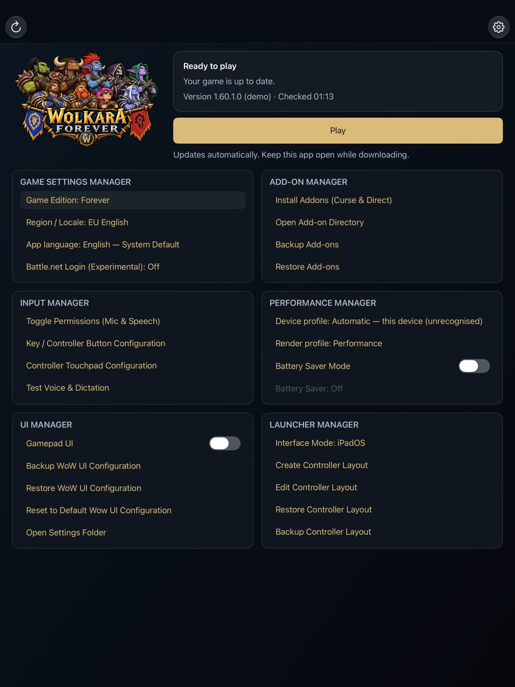

The page is six cards. The top of the page always shows what the launcher is doing and the one
button that starts, installs or repairs the game.

| Option | What it does | How to use it |
| --- | --- | --- |
| ⟳ **Check for updates** (top left) | Asks the game service again whether this edition has a newer build. The launcher otherwise checks once per launch. | Tap it after a network change, or when you want a check now. |
| ⚙ **Settings** (top right) | Opens the [Settings sheet](#settings-sheet). | Tap the gear. |
| **Play** | Starts the game. The same button reads **Install**, **Update needed to play**, **Repair installation**, **Try again**, **Startup unavailable** or **Close WolkaraForever** depending on what the game needs. | Wait for the ready state, then tap. While a download or a repair runs it shows the progress instead. |
| Status line and detail | One sentence about the current state: ready, not installed, update required, checking, updating, starting, running, or what went wrong. | Read it before pressing the button; the detail line names the phase and, during a download, how much is left. |
| Version line | The edition's installed version and when it was last checked, or installed versus available. | — |
| **Diagnostics and logs** (text button) | Opens the [Diagnostics](#settings-sheet) page. It appears only after a startup failure. | Tap it when the page says the game could not start. |
| "Updates automatically. Keep this app open while downloading." | Reminder that the launcher keeps the game current while it is open. | Hidden while the game is starting or running. |

### Game Settings Manager

| Option | What it does | How to use it |
| --- | --- | --- |
| **Game Edition: Forever** | Chooses which World of Warcraft edition the launcher manages. | Opens [Game Edition](#game-edition). Changing it never deletes the other edition's downloaded data. |
| **Region / Locale: EU English** | The game's region and the language its text and audio are downloaded in. | Opens [Region and game language](#region-and-game-language). |
| **App language: English** | The language of WolkaraForever's own labels. | Opens [App language](#app-language). It is a separate setting from the game's language. |
| **Battle.net Login (Experimental): Off** | Whether a launch may open Battle.net's own sign-in page first, and whether one game password is kept on this device. | Tap to open the sheet: **Enable experimental login** (asks you to acknowledge the risk), **Disable experimental login**, **Sign in with the saved password** (only while a password is saved), **Forget the saved password** and **Clear sign-in data**. |

### Add-On Manager card

| Option | What it does | How to use it |
| --- | --- | --- |
| **Install Addons (Curse & Direct)** | Opens the [Add-On Manager](#add-on-manager) on **My Add-ons**. | Tap. Until a game is installed the row says "install game first" and is disabled. |
| **Open Add-on Directory** | Opens the game's own `Interface/AddOns` folder in the Files picker, so you can drop a ZIP or a folder in. | Tap, then use **On My iPad** in the picker. |
| **Backup Add-ons** | Writes the whole add-on folder into one ZIP under the game's `WTF/Backups`. | Tap; nothing is replaced and nothing is deleted. |
| **Restore Add-ons** | Puts one of those backups back, replacing the add-on folder. | Tap, pick the backup, confirm **Replace**. |

### Input Manager card

| Option | What it does | How to use it |
| --- | --- | --- |
| **Toggle Permissions (Mic & Speech)** | Opens this app's page in the iPad's own Settings, where the microphone and speech switches live. | Tap, then switch on **Microphone** and **Speech Recognition** for WolkaraForever. |
| **Key / Controller Button Configuration** | Opens the dictation page. | See [Key / Controller Button Configuration](#key-controller-button-configuration). |
| **Controller Touchpad Configuration** | Opens the controller-touchpad pointer page. | See [Controller Touchpad Configuration](#controller-touchpad-configuration). |

### Performance Manager card

| Option | What it does | How to use it |
| --- | --- | --- |
| **Device profile: Automatic — …** | Which measured device profile the page draws for, and therefore which render scales are offered. | Opens [Device profile](#device-profile). Automatic follows the device it is running on. |
| **Render profile: Performance** | How much the game draws at, from Performance through Balanced to Quality. | Opens [Render profile](#render-profile). |
| **Battery Saver Mode** (switch) | Whether any battery-saving choice applies at all. **Off** is full performance: no frame limit, no AFK dim, and nothing installed on the game's presentation path. | Switch on, then choose on [Battery Saver options](#battery-saver). |
| **Battery Saver Options** | Opens the page holding the frame limit and the AFK saver. It opens whether the switch above is on or off, and the choices are remembered either way. | Opens [Battery Saver Options](#battery-saver). |

### UI Manager card

| Option | What it does | How to use it |
| --- | --- | --- |
| **Gamepad UI** (switch) | Whether the game exposes its gamepad interface. The launcher keeps the choice itself and writes `GamePadEnable` into `Config.wtf`, again immediately before every start, because the game rewrites that file when it exits. The game's own gamepad camera settings are never touched. | Switch on when you want the controller's interface; switch off for the keyboard/mouse one. |
| **Backup WoW UI Configuration** | Saves the game's interface settings (`WTF` and `Interface`) into one ZIP under `WTF/Backups`. | Tap before a large change. |
| **Restore WoW UI Configuration** | Puts a saved interface back, after taking a safety copy of what is there now. | Tap, pick a backup, confirm. |
| **Reset to Default Wow UI Configuration** | Removes only the game's graphics and display settings, after taking a safety copy. | Tap and confirm **Reset graphics**. It does not touch add-ons, key bindings or your installation. |
| **Open Settings Folder** | Opens the game's `WTF` folder in the Files picker. | Tap to edit or copy `Config.wtf` by hand. |

### Launcher Manager card

| Option | What it does | How to use it |
| --- | --- | --- |
| **Interface Mode: iPadOS** | Which interface the on-screen controls use: **Automatic**, **iPadOS**, **iOS** or **iOS on Duo**. | Opens [Interface Mode](#interface-mode). Changing it never installs, disables, removes or updates an add-on. |
| **Create Controller Layout** | Makes a layout from a starting point and saves it under a name you choose. | Tap, pick **Plain**, **Duo** or **Duo with room for an add-on**, then name it. |
| **Edit Controller Layout** | Opens the layout in use, row by row. | See [Controller Layout](#controller-layout). |
| **Restore Controller Layout** | Puts back a saved layout, imports one from a backup file, or deletes one. | Tap and pick. **Restore From a Backup File…** accepts a `WolkaraForever-Layout-….json` file. |
| **Backup Controller Layout** | Shares the layout in use as a JSON file. | Tap, then choose **Save to Files**, **Mail** or another destination in the share sheet. |

## Settings sheet

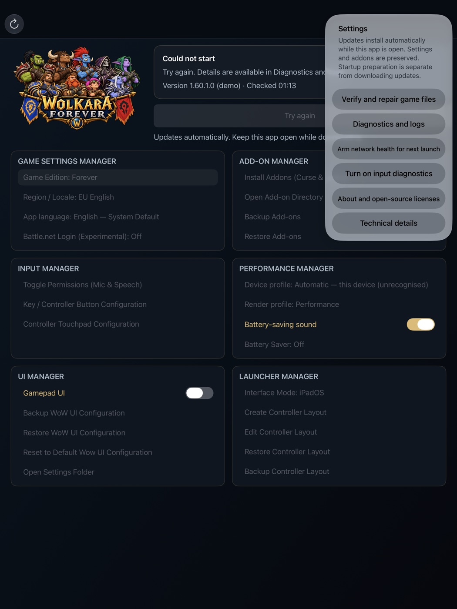

The gear on the home page opens one sheet with five rows, plus **Technical details** when something
has failed. The sheet's own line explains that updates install automatically while the app is open,
that settings and add-ons are preserved, and that startup preparation is separate from downloading
updates.

| Option | What it does | How to use it |
| --- | --- | --- |
| **Verify and repair game files** | Re-verifies every recorded game file and re-downloads the ones that are wrong, keeping your settings and add-ons. | Tap while the game is not running. It only appears when a game is installed and nothing is running. |
| **Diagnostics and logs** | Opens the Diagnostics page: the runtime checks, the local-route tests, the session-ending tests, and **Logs and reports** — every `.log` and `.txt` in the app's Documents folder, newest first. | Tap, then pick a file to read or share it. See [Send us a log](SENDING_LOGS.md). |
| **Arm network health for next launch** | Records anonymous TCP health counters for the next game launch, for at most 15 minutes, then disarms itself. | Tap once. The row then reads **Disarm network health for next launch**, and tapping it cancels the recording. |
| **Turn on input diagnostics** | Writes the controller inspector's event log during play. Off by default. | Tap to turn it on; the panel appears. Tap again to turn it off. |
| **About and open-source licenses** | Opens [About](#about). | Tap. |
| **Technical details** | Shows the exact reason for the last failure — the same sentence that is in the log. | Only offered after a failure. Tap, then copy the text. |

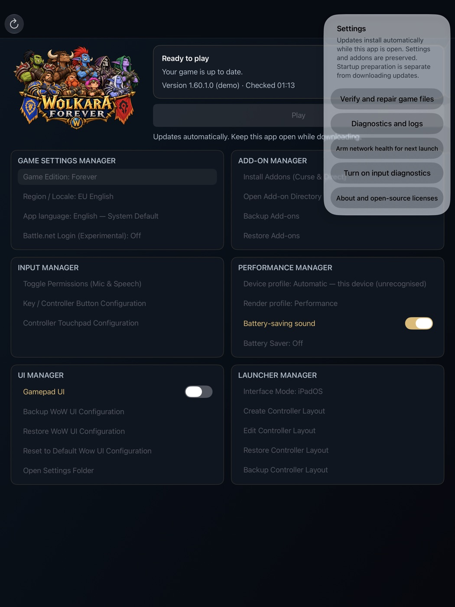

## About

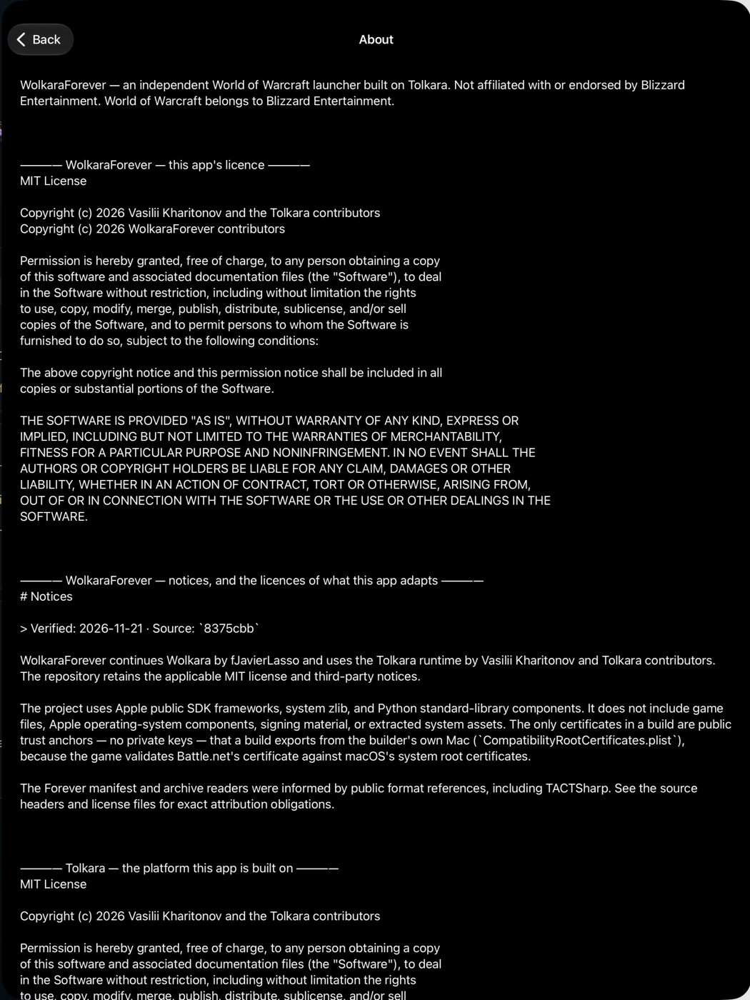

The About page names the app, says what it is and is not affiliated with, and then prints the four
licence documents that ship in the bundle: WolkaraForever's own licence and notice, and upstream
Tolkara's. A document that is missing from a build says so on the page instead of being silently
skipped. The app's version is not on this page; the first line of `wolkaraforever.log` carries it.

## Game Edition

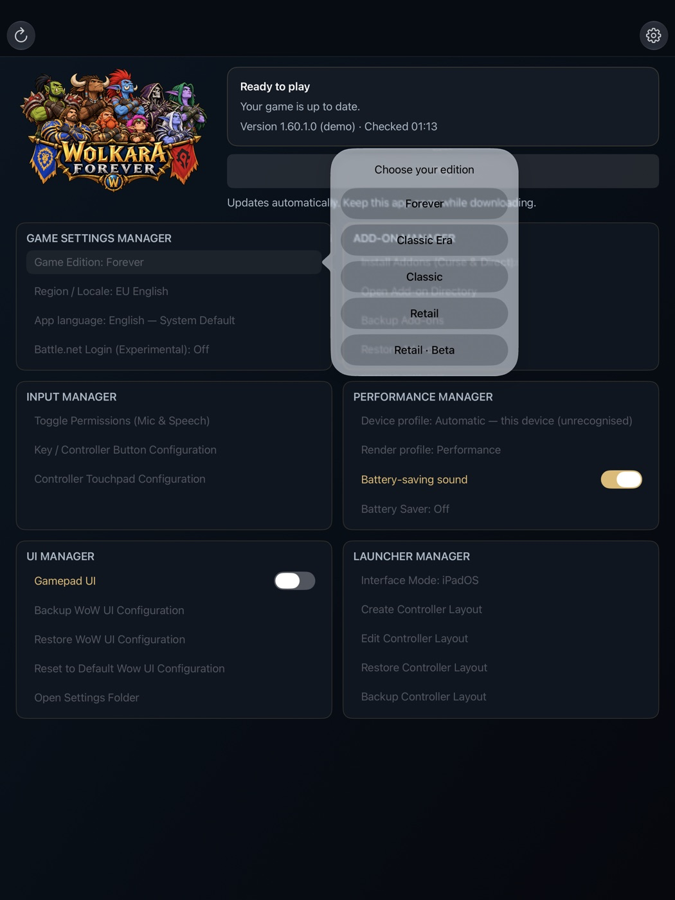

| Option | What it does |
| --- | --- |
| **Forever** | The Forever client. This is the edition the project is tested against and the one the user guide assumes. |
| **Classic Era**, **Classic**, **Retail**, **Retail · Beta** | The other clients the launcher can manage. Each keeps its own game data; choosing one never deletes another's. |

Pick one and the page re-renders for that edition. A different edition may need its own download
before **Play** becomes available.

## Region and game language

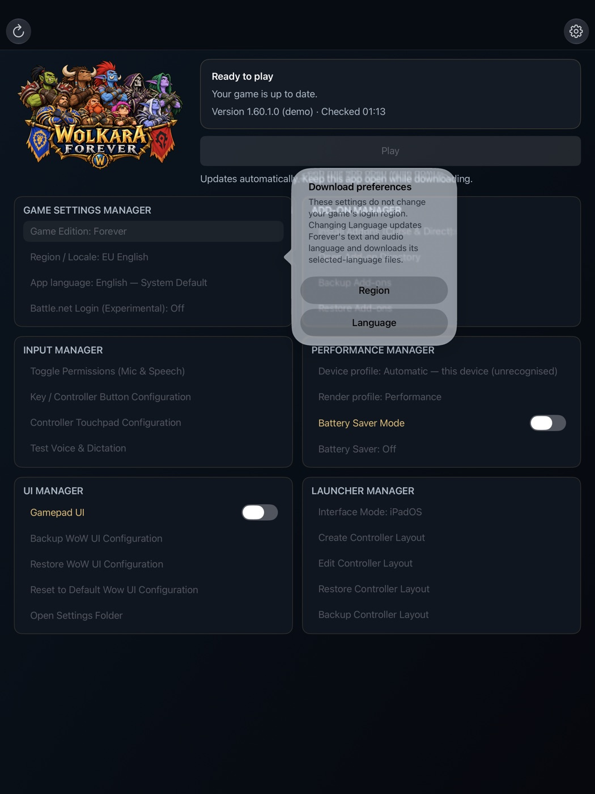

Two decisions, each its own sheet:

| Option | What it does |
| --- | --- |
| **Region** | Which regional game service the download uses: EU, US, KR or TW. It also decides which regional files are fetched. |
| **Language** | The game's text and audio language (for example English (US), Deutsch, Français, Español). Changing it downloads the selected-language files before **Play**. |

The row on the home page reads back both, for example `Region / Locale: EU English`. The launcher
writes each changed choice into the game's own `WTF/Config.wtf` (`portal`, `textLocale`,
`audioLocale`) while preserving every other game setting. The client reads those values at login.

## App language

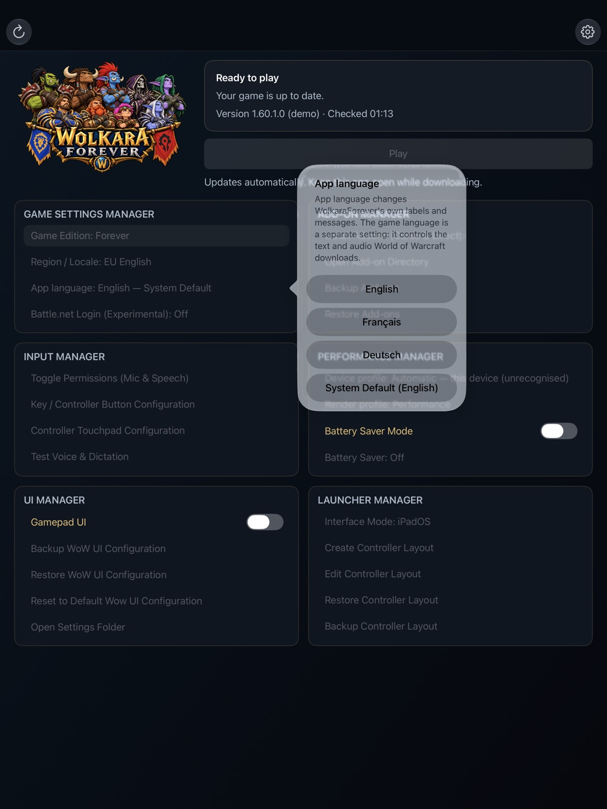

WolkaraForever's own labels and messages, separate from the game's language.

| Option | What it does |
| --- | --- |
| **English — System Default**, and the other supported languages | Draws the whole launcher in that language immediately. |
| The one-time offer after the first German or French choice | **Also change game language…** changes the game's text and audio too; **Keep game language unchanged** leaves the game as it is. The offer appears once. |

The game's language stays the [Region and game language](#region-and-game-language) setting, and the
page says so.

## Battery Saver

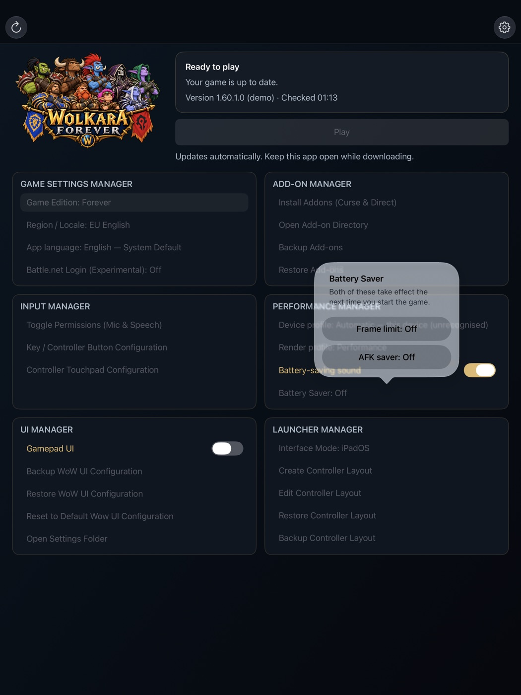

A page of its own, opened from **Battery Saver Options** on the home page. It opens whether
**Battery Saver Mode** is on or off: the choices are remembered on their own, and they are what the
switch applies. Everything here takes effect on the **next** game start — a change never disturbs a
game that is already running. Nothing here writes a game setting.

| Choice | What it does |
| --- | --- |
| **Frame limit** | Off, **Automatic** (60 frames per second on power, 30 on battery), **30 FPS** or **60 FPS**. Low Power Mode lowers any cap to 30; device temperature never changes it. The cap is applied to the frames the game already renders, so **Off** costs nothing. |
| **AFK saver** | Off, 2, 5 or 10 minutes. After that long without input the screen dims and the game is held at 10 frames per second. The first touch, key, mouse action or controller action only wakes it — it is not delivered to the game. Dimming pauses while anything is held, while the in-game touch configuration is open, and while the app is not in front. |

The current choice in each group is marked with a check.

## Device profile

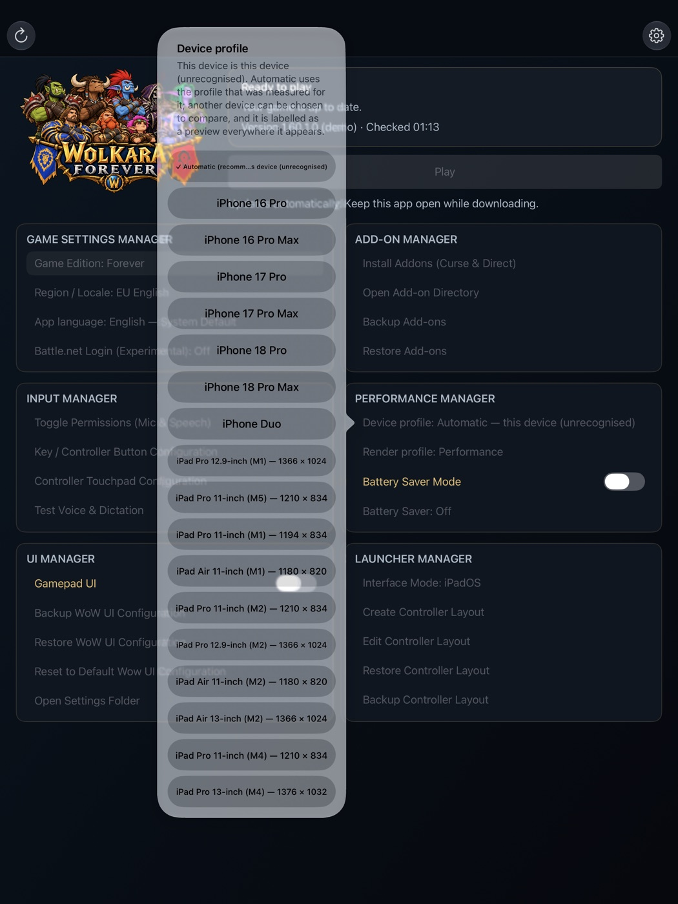

A device profile is the measured record of one iPad or iPhone model: the render scales that model
can hold, and what was observed on it. **Automatic** uses the model this device reports.

| Option | What it does |
| --- | --- |
| **Automatic (recommended) — \<device\>** | Uses this device's own record. This is the default. |
| A preview of another device | Draws the page for that device's record. Choosing one from the list asks first (**Preview profile**) because the page is then laid out for hardware you are not holding. |

The home page says which is in force, for example `Device profile: Automatic — iPad Pro 13-inch (M5)`, and says `Preview — <device>` while a preview is chosen.

## Render profile

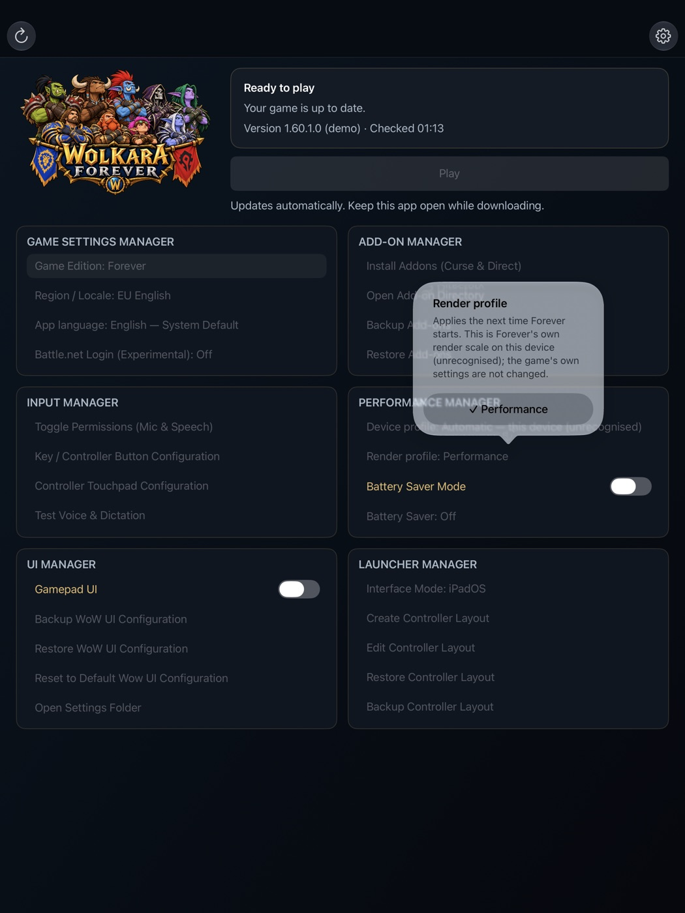

| Option | What it does |
| --- | --- |
| **Performance** | The smallest render scale. The default, and the cheapest. |
| **Balanced** | A middle scale. |
| **Quality** | The device's panel resolution where the record has one. Choosing above the device's recommendation asks first (**Above the recommendation**) and says what it costs: what is drawn and whether the record measured it missing the frame budget. |

These change only Forever's own render scale, and take effect the next time Forever starts. No
game file is edited.

## Interface Mode

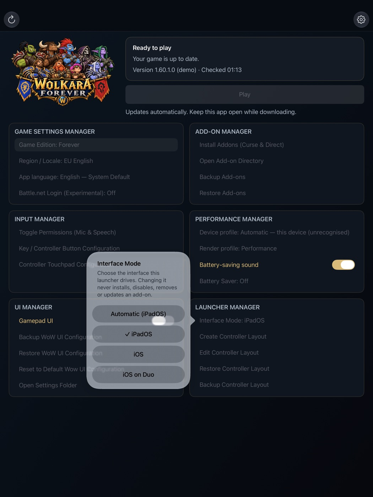

| Option | What it does |
| --- | --- |
| **Automatic (%@)** | Follows the device: the phone layout on an iPhone, the tablet layout on an iPad. |
| **iPadOS** | Always the tablet layout. |
| **iOS** | The phone layout without the Duo arrangement. |
| **iOS on Duo** | The compact phone layout with floating sticks and a corner jump button. This is what [Use WolkaraForever on iPhone](IPHONE.md) asks for on a phone. |

The sheet states the one rule that matters: changing the interface never installs, disables, removes
or updates an add-on.

## Controller Layout

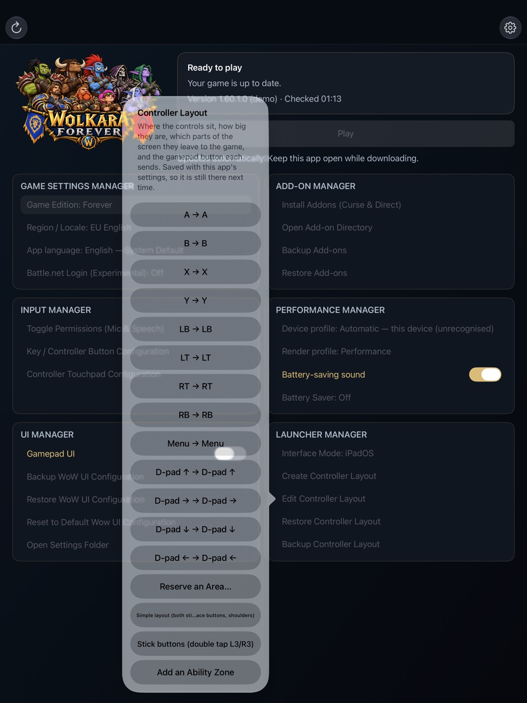

The layout decides where the on-screen controls sit, how big they are, which parts of the screen
they leave to the game, and which gamepad button each one sends. It is saved with the app's settings.

| Option | What it does |
| --- | --- |
| One row per control, for example **A → A** or **D-pad ↑ → D-pad ↑** | Chooses which gamepad element that on-screen control sends. The right-hand side is what the game receives. |
| **Reserve an Area…** | Drag a rectangle that the controls must keep clear, for something you need to see. |
| **Simple layout (both sticks, face buttons, shoulders)** | Hides the other buttons. |
| **Stick buttons (double tap L3/R3)** | Sends L3/R3 on a double tap of a stick. Offered only when the controller has those buttons. |
| **Add an Ability Zone** | Adds one more on-screen ability button, on the first unused element. |
| **Clear the Ability Zones** | Removes every ability zone. Only offered when there are some. |

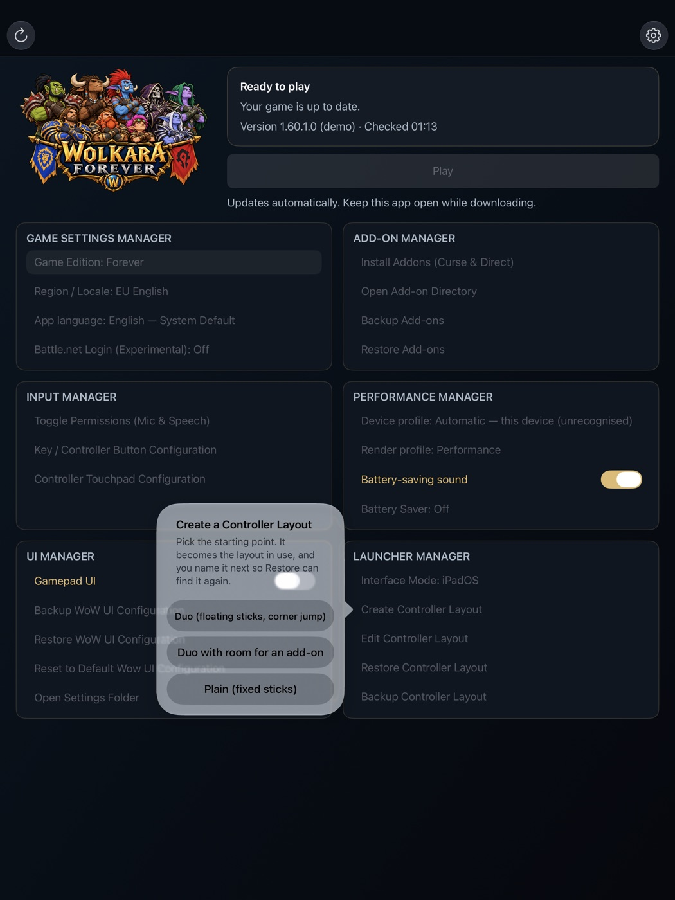

**Create Controller Layout** starts from **Plain (fixed sticks)**, **Duo (floating sticks, corner
jump)** or **Duo with room for an add-on**, applies it, and then asks for a name so **Restore** can
find it again.

## Add-On Manager

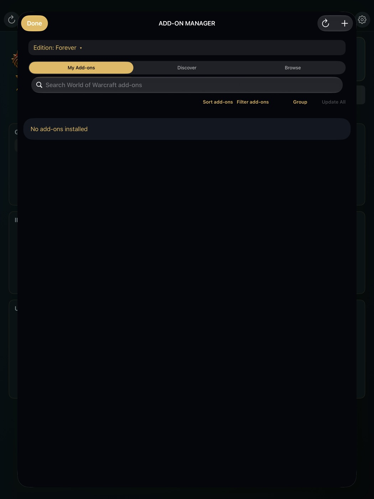

One page with three tabs, a search field and a toolbar that changes with the tab.

| Option | What it does |
| --- | --- |
| **My Add-ons** | Everything installed, with its update state and one action per row. |
| **Discover** | Three provider lists — **Featured**, **Latest**, **Popular**. |
| **Browse** | Provider search, with **Sort**, **Filters**, **Columns** and paging. |
| Search field | Filters **My Add-ons**, or is the query on **Browse**. |
| **+** (top right) | Imports a ZIP add-on from the Files picker. |
| ⟳ (top right) | Re-reads the installed add-ons and asks the provider about every linked package. |
| ⚙️ (top right) | **Change CurseForge key…** and **Remove key**. Removal asks first and deletes the key from this device's Keychain only. |
| **Update All** | Asks the provider about every eligible package and updates the ones with a newer file. It finishes when each archive has been written, so the rows settle together. |
| **Select**, **Select All**, **Clear**, **Update Selected** | Appear once a row is ticked, for updating a few packages at once. |
| **Group** | Puts add-ons into a named group in this list. |
| Row state and action | One word about the update and the action that goes with it: **Update available · Update**, **Not checked yet · Update**, **Up to date**, **Checking… · Updating…**, **Downloading…**, **Check failed — retry · Retry**, **Check failed · Manage**, **Needs browser confirmation · Open**, **No linked project · Link**, **Update unavailable · Unavailable**, **Held back · Manage**. |
| Row tap | Opens the package's own sheet: where it came from, when it was installed and last checked, then **Update**, **Disable**/**Restore**, **Pin this version**/**Allow updates again**, **Link project**/**Unlink project**, **Groups**, **Remove from device**. |
| **Set up CurseForge access** (no key yet) | Opens the key sheet. Browse and Discover show it until a key is saved. |
| **Load more…** | Fetches the next page of provider results. |

A package with no recorded provider identity cannot be updated from the provider; **Link** tells the
manager which project it is. **Remove from device** deletes that package's folder and nothing else.

## Key / Controller Button Configuration

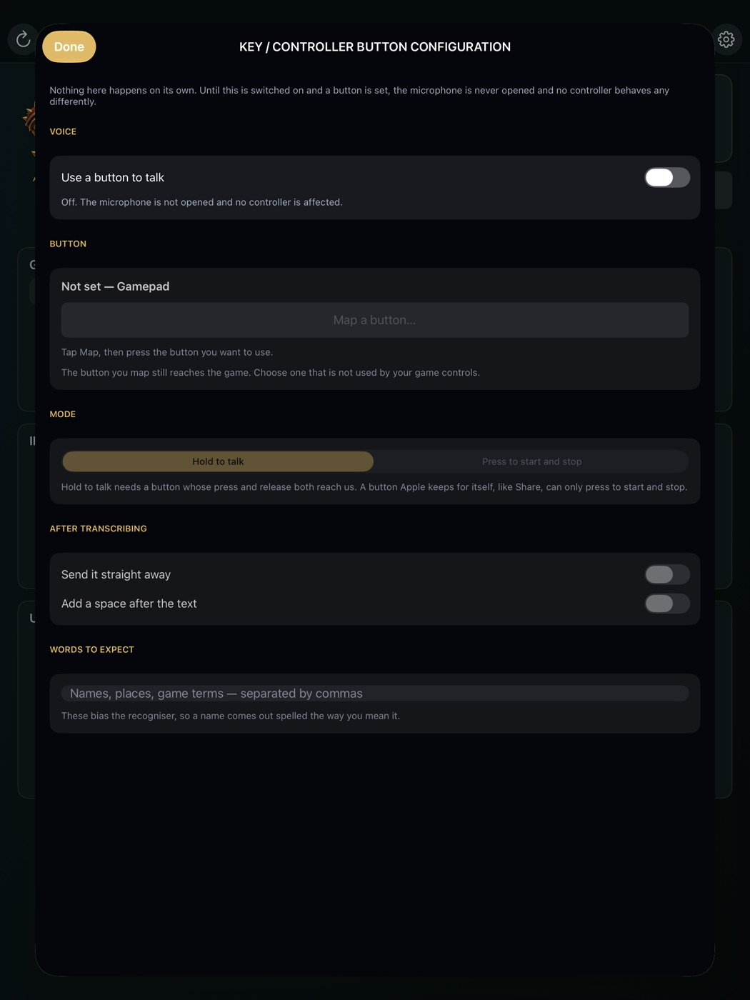

| Option | What it does |
| --- | --- |
| **Use a button to talk** (switch) | Turns dictation on or off. Everything else on the page is dimmed until it is on. |
| Mapping line | What the button currently is, or **Not set**. |
| **Map a button…** | Waits for the next button you press and stores it for that controller. |
| **Clear** | Forgets the mapping for this controller. |
| **Test Dictation** | Opens **Test Voice**, which shows what the microphone heard and lets you edit it. |
| **Hold to talk** / **Press to start and stop** | Which behaviour the mapped button has. A button Apple keeps for itself can only press to start and stop. |
| **Send it straight away** (switch) | Presses Return after the text is typed. |
| **Add a space after the text** (switch) | Adds a trailing space, for chaining two dictations. |
| **Words field** | Names, places and game terms you want recognised, separated by commas. |

## Controller Touchpad Configuration

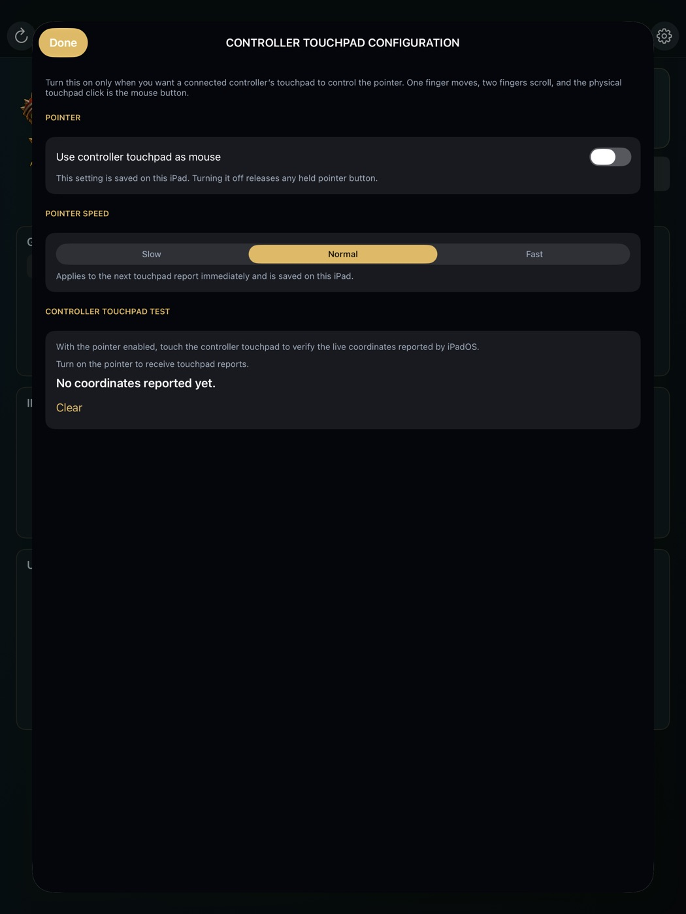

| Option | What it does |
| --- | --- |
| **Use controller touchpad as mouse** (switch) | Turns the controller's touchpad into a pointer. Off by default and saved on this iPad. |
| **Pointer speed**: **Slow**, **Normal**, **Fast** | How far one finger moves the pointer. Applies immediately. |
| **Controller touchpad test** | Live readout: waiting, receiving, or the reported finger count and coordinates, plus click down/up. **Clear** resets it. |

While the pointer is on, one finger moves, two fingers scroll, and the physical touchpad click is the
mouse button (two fingers on the pad presses the right button). Tapping without pressing does
nothing, so a resting thumb does not click. The touchpad and a physical mouse hand off to each other
when the controller contact ends.

## In-game toolbar and touch settings

These controls are drawn over the game while it runs, so they cannot appear in the launcher pictures
above. [Use WolkaraForever](USING_WOLKARAFOREVER.md) covers how to use them; the list here is what
each one is.

| Option | What it does |
| --- | --- |
| Keyboard button | Shows or hides the game's keyboard. |
| Trackpad button | Enables or disables the touch trackpad. Long-press it for **Left click**, **Right click** and **Middle click**. |
| Gamepad button | Chooses **Automatic**, **Active** or **Off** for the on-screen controller. |
| Gear button | Opens **Touch controls**. |
| House button | Asks before leaving the game. |
| Toolbar handle | Shows or hides the toolbar itself; the choice is saved. |
| **Transparency** | How solid the on-screen controls are. |
| **Shoulder button size**, **Sticks and face button size** | The size of the controls. |
| **Sticks and jump only** | Hides every other button (phone layout). |
| **Floating sticks** | Sticks that find your thumb, with jump in the corner (phone layout). |
| **Triggers on the outside** | Which side the shoulder buttons sit on. Greyed in the simple layout. |
| **Haptic feedback** | Controller vibration. |
| **Performance overlay (FPS & Thermals)** | Draws the frame rate, GPU, thermal state, memory, battery and power state over the game. Tap it to collapse, drag it to move. |
| **Edit layout** | Enters the drag editor, where each control can be moved and each ability zone can pick its button. |
| **Simple layout**, **Stick buttons** | The same two choices as in the launcher's Controller Layout, in-game. |
| **Ability zones** (**Add**, **Clear**) | Adds or removes on-screen ability buttons while you play. |
| **Reset to defaults** | Puts every control back where it started. |
| Keyboard accessory row | **Esc**, **Tab**, ←, →, ⌫, ↵ and the keyboard-restore key, plus the yellow saved-password key while the game's password field has the keyboard and experimental login is on. |
