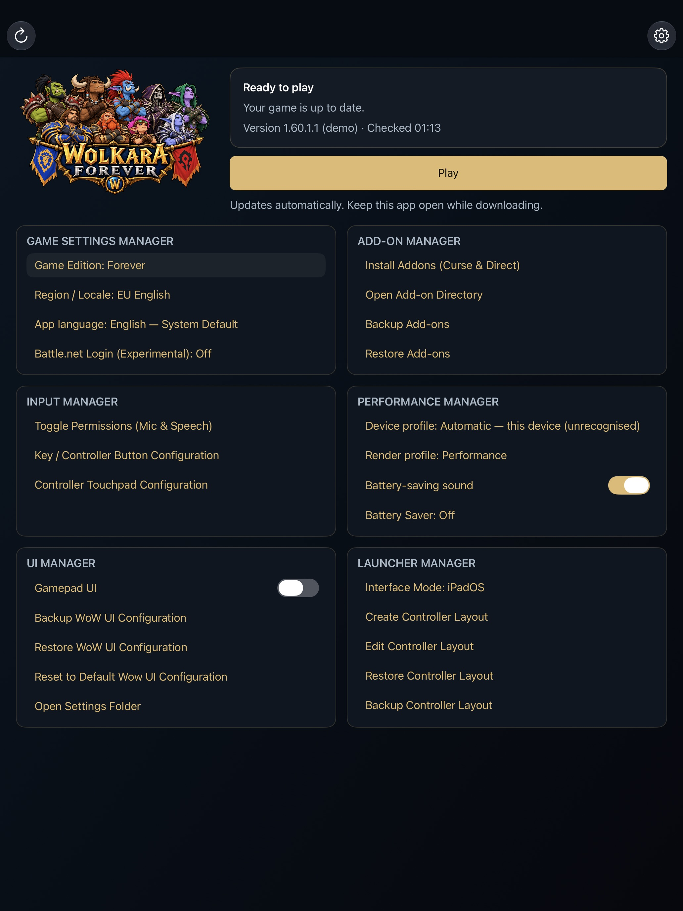
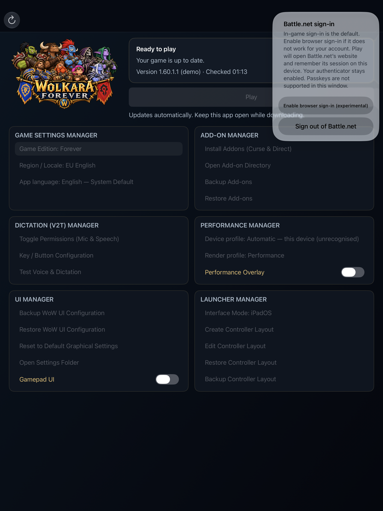
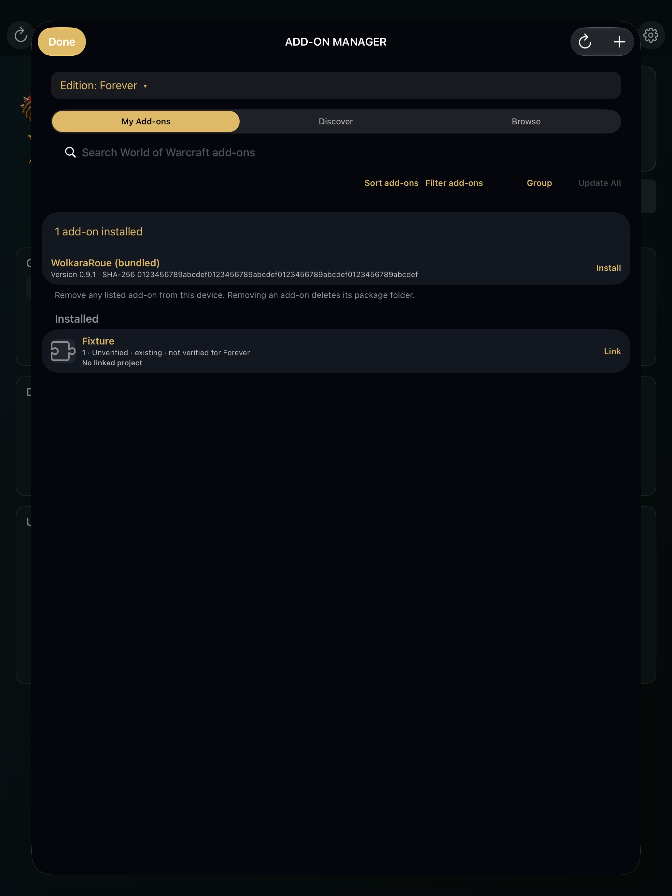

# Use WolkaraForever

> Verified: 2026-11-13 · Source: `3c33543`

Use the launcher to prepare Forever, configure the interface, and recover safely when a setting or add-on causes a problem.

## Set up and update your game

1. On the home screen, select Forever, your region, and the game language.
2. Start the download. The launcher can resume, verify, repair, and update recorded game data.
3. Wait for the ready state before selecting **Play**.

Changing game language can require additional files. App language and game language are separate settings.

## Optional Battle.net browser sign-in

If in-game login disconnects after verification, open **Settings → Battle.net sign-in** and choose
**Enable browser sign-in (experimental)**. This setting is off by default. Press
**Play**: after checking the game files, the launcher opens Battle.net's official
sign-in page and continues into WoW after successful sign-in. Cancel returns to the
launcher without starting the game. Your password and authenticator stay in
Battle.net's website; the launcher does not store your password.

The website session is saved in a separate browser store inside this app. Battle.net
may reuse it on later launches or ask you to authenticate again. **Sign out of
Battle.net** removes that saved session and the temporary launch ticket. **Disable
browser sign-in** restores direct in-game login and clears the launch ticket; use
Sign out as well if you want to remove the saved website session.

Launch tickets are cleared on app restart and rejected after ten minutes. Never
share tickets or callback URLs in issue reports. Passkeys are not supported in this
embedded window; use another sign-in method offered by Battle.net. This optional
handoff is adapted from [Waypoint](https://github.com/wowlocal/waypoint-launcher)
and leaves the game executable unchanged.

## Change app language or interface

Open **Settings** to choose an app language. Open **Launcher Manager** to choose **iPadOS** or **iOS on Duo**. Interface selection changes the arrangement only; it does not change game data or add-ons.

## Manage add-ons

Open **Add-On Manager** to view recorded packages, install the bundled WolkaraRoue package, import a validated archive, or browse a supported provider. An optional provider key stays in the device Keychain. The app removes only add-ons it recorded as managed.

A provider tab without a key shows one **Set up access** row; opening it asks for the key and then loads the tab. When a key is saved, use the **⚙️** button in the Add-on Manager’s top bar to **Change CurseForge key…** or **Remove key**; removal is confirmed and leaves the key only deleted from this device's Keychain. Each installed row shows the package's name, version, author and its CurseForge thumbnail once the package records a provider identity, and one word about its update with the action that goes with it: **Update**, **Check**, **Retry**, **Open**, **Link** or **Manage**. **Not checked yet** means nothing has asked the provider about that package yet, and **Check** is what asks; **Update** asks anyway and either installs the newest file or reports that the package is current. **Update All** runs the same question for every eligible package and finishes when each one has been written, so rows settle together rather than returning to **Not checked yet**.

## Back up or recover your interface

Use **UI Manager** before large interface changes. Create a backup, restore a selected backup if the interface becomes unusable, and use the graphics reset only for graphics and display settings. Recovery does not replace the game installation.

## Configure controls and voice

Use the touch toolbar, trackpad, keyboard, gamepad, physical keyboard, or controller that fits your device. For dictation, open voice configuration, grant permission, select a trigger and Hold or Toggle behavior, then use **Test Voice** before dictating into a text field. Enabling dictation establishes the game's duplex audio route before a controller hold; the hold and release themselves do not change the audio category or remove the game output route. Leaving the app stops an open dictation capture, but does not add a WolkaraForever frame cap to the running guest.

## Get help safely

Open **Settings > Technical details** and record the exact message. Share only a redacted log when requested. Do not share credentials, pairing data, signing information, account information, or device identifiers. Do not delete the app as a first troubleshooting step.
