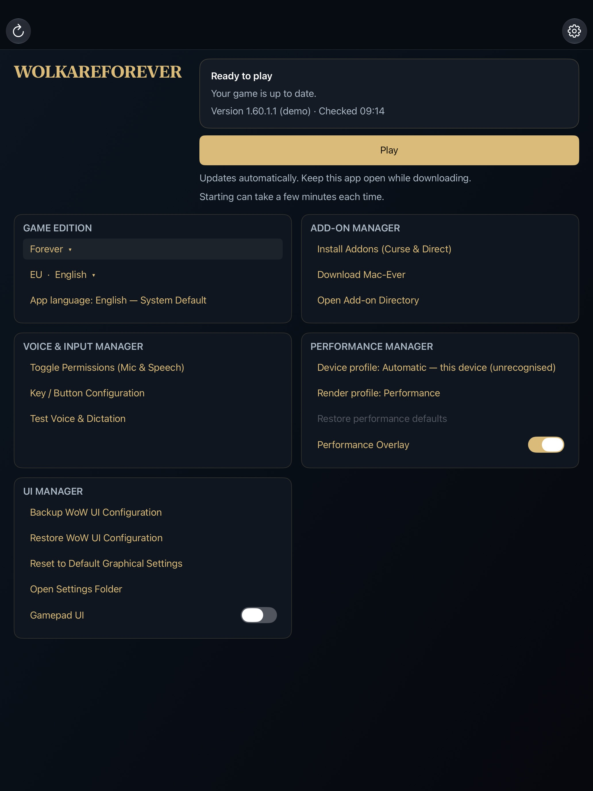
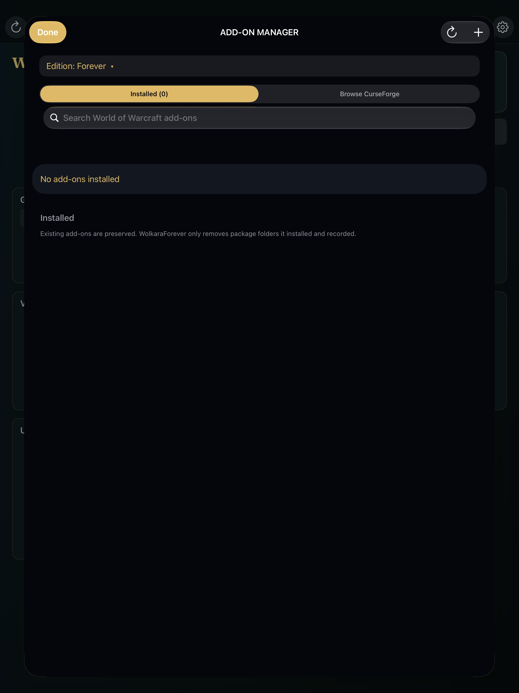
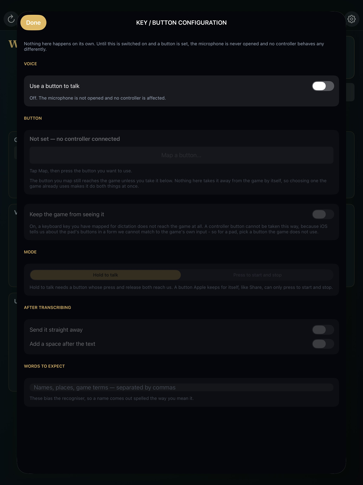
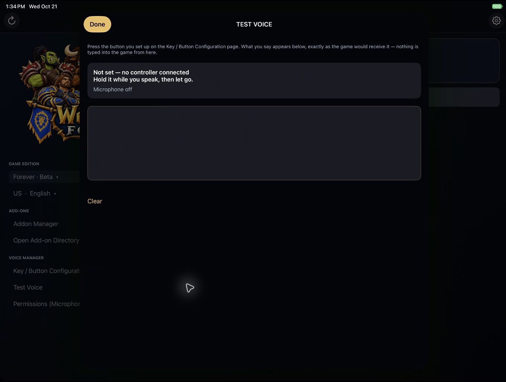
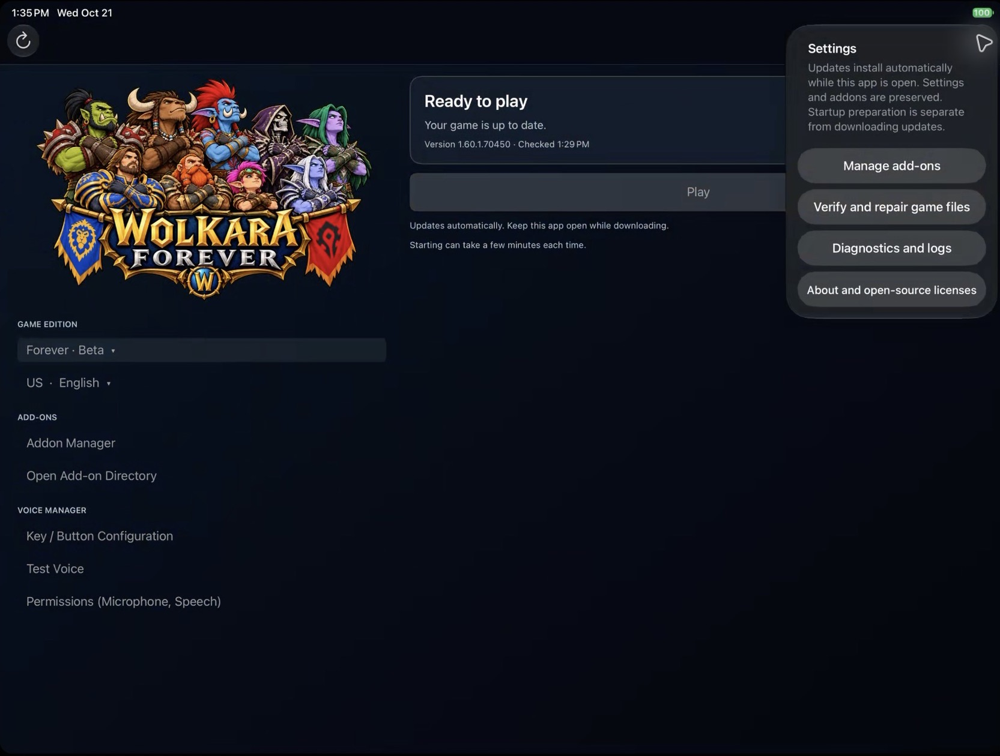

# Using WolkaraForever

This is the in-app guide for a WolkaraForever installation that has already
been built, installed, and enrolled. For first-time setup, see
[Build and run WolkaraForever](GETTING_STARTED.md).

The screenshots below were captured from the installed app on an iPad. Your
edition, client version, add-ons, and button mapping will differ.

## Home

The home screen is where you choose the game edition and download preferences,
manage add-ons, set up voice input, and start the game.

1. Tap the edition name to choose **Forever · Beta**, **Classic Era**,
   **Classic**, **Retail**, or **Retail · Beta**. This selects the client
   WolkaraForever prepares; it does not change your game account or entitlement.
2. Tap the region/language label (for example, **US · English**) for download
   preferences. **Region** offers Europe, Americas, Korea, and Taiwan;
   **Language** offers English and Spanish. These choices select download
   content only; they do not change the game's login region.
3. Keep WolkaraForever open while it downloads or installs an update. **Play** becomes
   available only after the selected client is ready.

While the game is starting, the home page says **Starting…** and the rows that would
change something are grey; they become gold again when they are usable. Once the game's
window is up, the page says **Running** and stays that way while you play. Quit the game
from its own menu and WolkaraForever returns here with **Game closed**: the game can only
be entered once in a process, so the only way to play again is to close WolkaraForever and
open it again. The **Close WolkaraForever** button on that state does exactly that — if the
game's window is still on screen after quitting from inside, closing the app is how you
get back to the home screen.
4. Tap **Play**, wait for startup preparation to finish, then sign in to the
   game yourself.

Updates preserve the app's settings and add-ons. Starting the game can take a
few minutes even when the client is already up to date.

## Add-ons

Open **Install Addons (Curse & Direct)** to see the installed packages for the selected edition.

- **Installed** lists the packages on this device. Use the search field to
  narrow the list. The circular-arrow button refreshes the displayed list.
  Select an add-on to manage it: **Disable** or **Restore** changes whether it
  loads, **Pin this version** or **Unpin updates** controls its update version,
  and **Remove managed package** removes only that managed package. Choose
  **Cancel** to make no change.
- **Browse CurseForge** searches available add-ons. It requires an approved
  CurseForge Core API key before results can be displayed; enter that key only
  if you have approval to use it. The key is the `$2a$…` string the CurseForge
  developer console issues for the approved application, stored only in this
  device's Keychain. Once access is configured, the page lists real projects the
  way the CurseForge site does: artwork, name and current file, downloads, a
  popularity rank, the last update date, category, game version and author.
  **Sort** offers Featured, Popularity, Last Updated, Name, Author, Total
  Downloads and Release Date, and tapping the field in use reverses its order;
  **Filters** narrows to one game version or category (and can be cleared), and
  the count above the list follows both. **Columns** chooses which of the six
  fields the list shows, and the choice is remembered; it never hides the name.
  Sorting and filtering are the site's own; the rank is CurseForge's, not a
  position in the current list.
- The **plus** button opens Files so you can select one add-on archive to
  import. **Open Add-on Directory** opens the app's add-on folder. Neither
  action changes an add-on until you choose an item or complete its action.
- **Done** returns to the home screen.

The installed list identifies add-ons managed by WolkaraForever. Existing add-ons are
preserved; WolkaraForever removes only package folders it installed and recorded.
Do not change an add-on while an update or game-start preparation is underway.

## Performance & UI Manager

The last box on the home page holds Forever's own file operations and two
WolkaraForever switches. The file operations need an installed, ready Forever
edition and no update, start or session in progress.

- **Backup WoW UI Configuration** writes a verified ZIP of `WTF` (without its
  `Backups` folder) and `Interface` into `WTF/Backups`, and names it.
- **Reset to Default Graphical Settings** asks first. It makes a backup, then
  removes only the graphics and display settings from `Config.wtf`; accounts,
  locale, audio, input, gamepad configuration, bindings, SavedVariables and
  unknown settings are kept byte for byte. Forever regenerates its graphics
  defaults when it next starts.
- **Restore WoW UI Configuration** opens Files at `WTF/Backups`; choose the
  `WoW-UI-…zip` to bring back. A snapshot of the current state is made first,
  so a restore can itself be undone, and every other backup is kept.
- **Gamepad UI** is a switch that writes `SET GamePadEnable` in `Config.wtf`.
  It changes no bindings and takes effect when Forever next starts.
- **Performance Overlay** is a switch for the in-game HUD (frame rate, frame
  time, thermal state, battery, memory and Low Power Mode). It is off by
  default and applies immediately. The in-game controller settings have the
  same switch.
- **Open Settings Folder** opens Files at the Forever `WTF` folder.

## Voice input

Voice dictation has been extensively validated by the user on the physical iPad,
both in **Test Voice** and in the running game. Your own controller, permissions,
and game field can differ, so use **Test Voice** after changing a mapping.

### Configure a button

Open **Key / Button Configuration**, turn on **Use a button to talk**, then
tap **Map a button** and press the control you want to use. Voice does not open
the microphone until voice is on and a button is mapped.

- **Use a button to talk** enables or disables button-controlled voice input.
- **Map a button** waits for the next supported keyboard or controller input;
  **Clear** appears after a mapping exists and removes that mapping.
- **Hold to talk** records while the button is held; release it to transcribe.
- **Press to start and stop** starts recording on one press and stops on the
  next. Use this with a control for which iPadOS does not deliver a release.
- **Send it straight away** sends Return after the transcript is inserted.
  Turn it off if you want to review text in the game first.
- **Add a space after the text** appends a space instead of ending the message.
- **Words to expect** accepts comma-separated names, places, and game terms to
  help speech recognition prefer their spelling.

By default the mapped input still reaches the game. Choose a controller button
the game does not use. **Keep the game from seeing it** works for a mapped
keyboard key, not for a controller button.

### Test the mapping

Use **Test Voice** before opening the game. Hold the mapped button while you
speak, then release it; the transcript appears in the large box. This screen
does not type text into the game. The transcript box is editable and **Clear**
only clears this test text. The status describes the current state: off,
waiting for the button, listening, or finalizing the transcript. If it says
that no controller is connected, connect the controller, return to **Key /
Button Configuration**, and map it.

### Allow microphone and speech access

Tap **Permissions (Microphone, Speech)** on the home screen. It opens the
WolkaraForever page in iPad Settings. Turn on **Microphone** and **Speech
Recognition** there, then return to WolkaraForever and run **Test Voice** again. The
app cannot grant or reset these iPad permissions itself.

## Settings and recovery

Tap the gear in the upper-right corner for these actions:

- **Manage add-ons** opens the Add-on Manager.
- **Verify and repair game files** checks the local client when it is damaged
  or an update cannot complete. It can download or replace damaged content, so
  use it only when you intend to repair the selected client.
- **Diagnostics and logs** is the first stop for a launch or update failure.
  Save the displayed message and a redacted log when asking for help; never
  share account credentials, pairing material, or device identifiers.
- **About and open-source licenses** shows WolkaraForever's license notices.

If the app is installing an update or preparing to start the game, let that
operation finish before changing add-ons or retrying Play.
