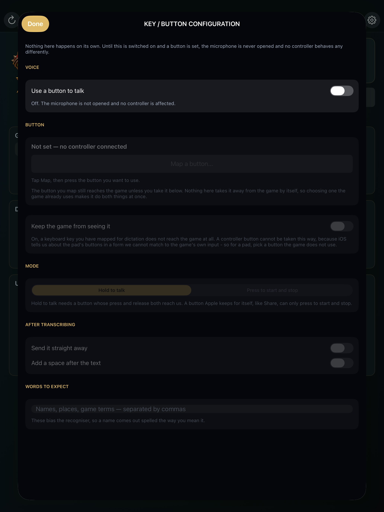

# Use WolkaraForever

> Verified: 2026-11-16 · Source: `9680e63`

Use the launcher to prepare Forever, configure the interface, and recover safely when a setting or add-on causes a problem.

## Set up and update your game

1. On the home screen, select Forever, your region, and the game language.
2. Start the download. The launcher can resume, verify, repair, and update recorded game data.
3. Wait for the ready state before selecting **Play**.

Changing game language can require additional files. App language and game language are separate settings.

## Choose how a game starts

The first time you start a game with no mode chosen, the launcher asks how to start it. **Developer service** is the supported route and is what [Install WolkaraForever](INSTALLATION.md) sets up; **Local signing** and **External JIT** need their own setup first. The choice cannot be skipped on that first start, it is remembered afterwards, and the **Execution Mode** button on the library screen changes it. [Build and run WolkaraForever](BUILDING.md) explains what each mode needs.

## Optional Battle.net browser sign-in

If in-game login disconnects after verification, open **Settings → Battle.net sign-in** and choose
**Enable browser sign-in (experimental)**. This setting is off by default. Press
**Play**: after checking the game files, the launcher opens Battle.net's official
sign-in page and continues into WoW after successful sign-in. Cancel returns to the
launcher without starting the game. Your password and authenticator stay in
Battle.net's website; the launcher does not store your password.

Nothing about the sign-in is saved to storage. The website session lives in memory
and ends when the app closes. The launch ticket is kept in memory until the game
starts, is used once, and is removed from the game's launch settings as soon as the
game has read it (or when the game closes, or after ten minutes). **Sign out of
Battle.net** ends the website session and drops any ticket. **Disable browser
sign-in** restores direct in-game login and drops any ticket.
These settings remain available while idle even if the game is missing or an
update check fails. If you open another panel while Play checks for updates,
close it and press Play again to sign in.

Launch tickets are cleared on app restart and expire after ten minutes. Never
share tickets or callback URLs in issue reports. Passkeys are not supported in this
embedded window; use another sign-in method offered by Battle.net. This optional
handoff is adapted from [Waypoint](https://github.com/wowlocal/waypoint-launcher)
and leaves the game executable unchanged.

## Change app language or interface

Open **Settings** to choose an app language. Open **Launcher Manager** to choose **iPadOS** or **iOS on Duo**. Interface selection changes the arrangement only; it does not change game data or add-ons.

## Manage add-ons

Open **Add-On Manager** to view recorded packages, install the bundled WolkaraRoue package, import a validated archive, or browse a supported provider. An optional provider key stays in the device Keychain. The app removes only add-ons it recorded as managed.

A provider tab without a key shows one **Set up access** row; opening it asks for the key and then loads the tab. When a key is saved, use the **⚙️** button in the Add-on Manager’s top bar to **Change CurseForge key…** or **Remove key**; removal is confirmed and leaves the key only deleted from this device's Keychain. Each installed row shows the package's name, version, author and its CurseForge thumbnail once the package records a provider identity, and one word about its update with the action that goes with it: **Update**, **Check**, **Retry**, **Open**, **Link** or **Manage**. **Not checked yet** means nothing has asked the provider about that package yet, and **Check** is what asks; **Update** asks anyway and either installs the newest file or reports that the package is current. **Update All** runs the same question for every eligible package and finishes when each one has been written, so rows settle together rather than returning to **Not checked yet**.

## Back up or recover your interface

Use **UI Manager** before large interface changes. **Gamepad UI** is first; its state is written to the active Forever `Config.wtf`. Create a backup before restoring a selected backup if the interface becomes unusable. **Reset to Default Wow UI Configuration** resets only graphics and display settings. Recovery does not replace the game installation.

## Configure controls and voice

Use the touch toolbar, trackpad, keyboard, gamepad, physical keyboard, or controller that fits your device. For dictation, open voice configuration, grant permission, select a trigger and Hold or Toggle behavior, then use **Test Voice** before dictating into a text field. Enabling dictation establishes the game's duplex audio route before a controller hold; the hold and release themselves do not change the audio category or remove the game output route. Leaving the app stops an open dictation capture, but does not add a WolkaraForever frame cap to the running guest.

A DualSense or DualShock 4 touchpad can move the game's pointer. In **Input Manager**, open **Controller Touchpad Configuration**. It is off until you turn it on and is saved on the iPad. One finger moves the pointer and two fingers scroll. Pressing the touchpad is the left mouse button, or the right button with two fingers on the pad, and pressing while you slide drags. Tapping without pressing does nothing, so a thumb resting on the pad does not click. The controller touchpad and a physical mouse or trackpad hand off when the controller contact ends; iPadOS's duplicate mouse stream for the controller surface is ignored while that contact or click is active. The page offers Slow, Normal and Fast speeds plus a live controller-touchpad test showing the reported finger count and coordinates. While this is on, the touchpad click is the mouse button only and cannot be chosen as a dictation trigger. The dictation test is inside **Key / Controller Button Configuration**. A DualSense Edge connected over Bluetooth can omit touchpad reports on iPadOS; use its USB-C connection when the live test remains empty.

## Get help safely

When something fails, send a log — it is three taps and needs no computer:
[Send us a log](SENDING_LOGS.md) shows where **Settings → Diagnostics and logs → Logs and
reports** is, which file to pick, and how to share it.

If a failure offers **Technical details** in the Settings sheet, copy that message too: it is
the exact reason, and it matches a line in the log. Do not share credentials, pairing data,
signing information, account information, or device identifiers, and do not delete the app
as a first troubleshooting step — the log you need goes with it.
