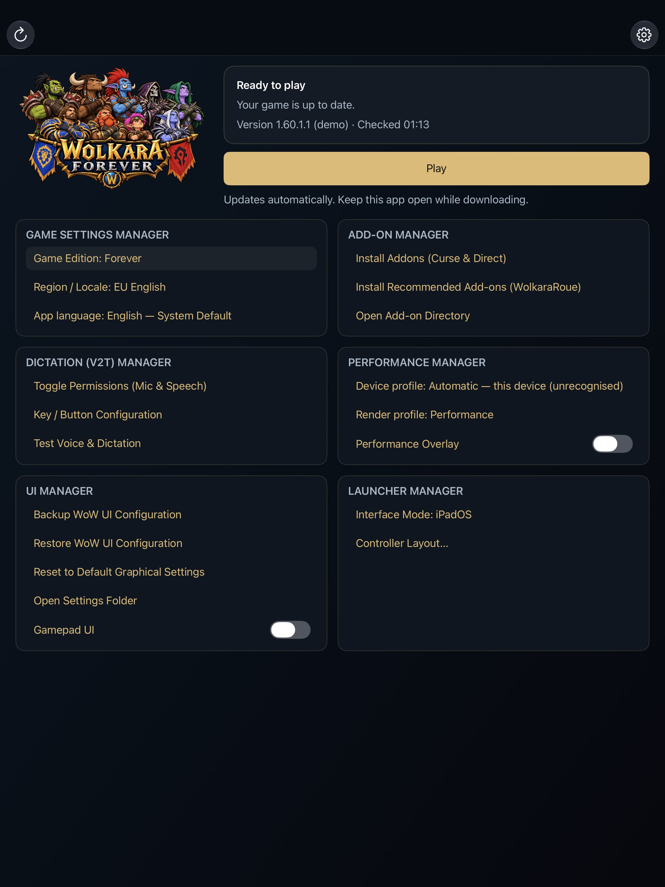
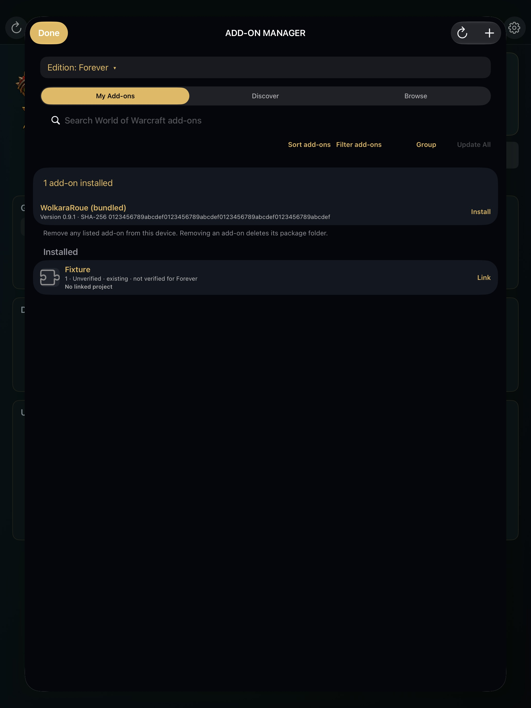
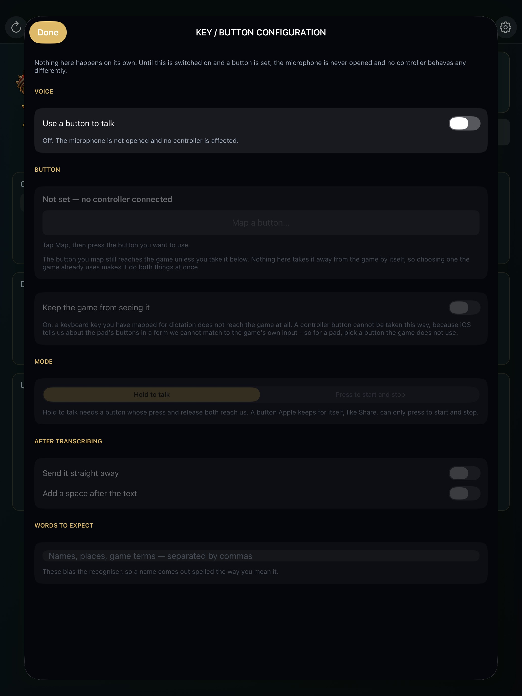

# Use WolkaraForever

> Verified: 2026-11-13 · Source: `3c33543`

Use the launcher to prepare Forever, configure the interface, and recover safely when a setting or add-on causes a problem.

## Set up and update your game

1. On the home screen, select Forever, your region, and the game language.
2. Start the download. The launcher can resume, verify, repair, and update recorded game data.
3. Wait for the ready state before selecting **Play**.

Changing game language can require additional files. App language and game language are separate settings.

## Change app language or interface

Open **Settings** to choose an app language. Open **Launcher Manager** to choose **iPadOS** or **iOS on Duo**. Interface selection changes the arrangement only; it does not change game data or add-ons.

## Manage add-ons

Open **Add-On Manager** to view recorded packages, install the bundled WolkaraRoue package, import a validated archive, or browse a supported provider. An optional provider key stays in the device Keychain. The app removes only add-ons it recorded as managed.

## Back up or recover your interface

Use **UI Manager** before large interface changes. Create a backup, restore a selected backup if the interface becomes unusable, and use the graphics reset only for graphics and display settings. Recovery does not replace the game installation.

## Configure controls and voice

Use the touch toolbar, trackpad, keyboard, gamepad, physical keyboard, or controller that fits your device. For dictation, open voice configuration, grant permission, select a trigger and Hold or Toggle behavior, then use **Test Voice** before dictating into a text field.

## Get help safely

Open **Settings > Technical details** and record the exact message. Share only a redacted log when requested. Do not share credentials, pairing data, signing information, account information, or device identifiers. Do not delete the app as a first troubleshooting step.
