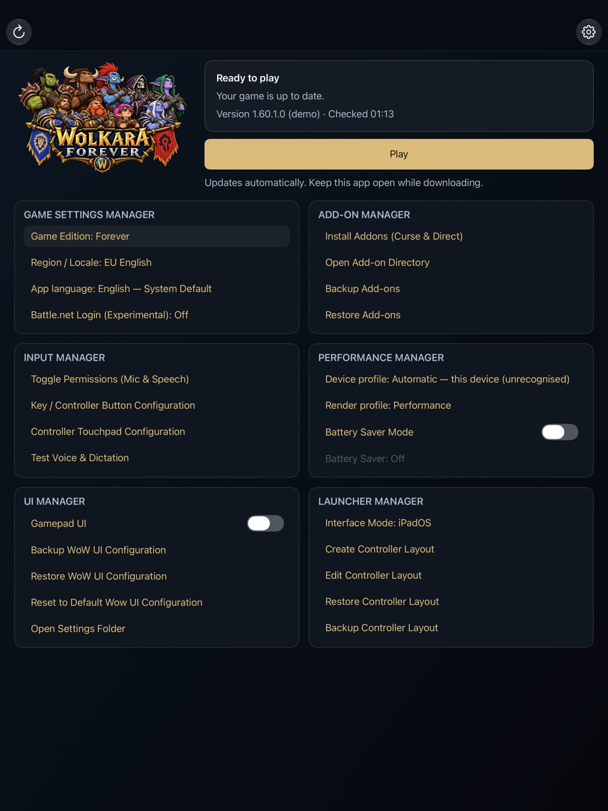

# Use WolkaraForever

> Verified: 2026-11-21 · Source: `8375cbb`

Use the launcher to prepare Forever, configure the interface, and recover safely when a setting or add-on causes a problem. Every control is listed with a picture in [What every control does](UI_REFERENCE.md).

## Set up and update your game

1. On the home screen, select Forever, your region, and the game language.
2. Start the download. The launcher can resume, verify, repair, and update recorded game data.
3. Wait for the ready state before selecting **Play**.

Changing game language can require additional files. App language and game language are separate settings.

## Choose how a game starts

The launcher starts the game the way it was built to. The app [Install WolkaraForever](INSTALLATION.md) builds uses **Developer service**; the unsigned package uses **External JIT**. A build made with `TOLKARA_MODE` set carries that route, and it is remembered once used, so the home page does not ask — it has no chooser. [Build and run WolkaraForever](BUILDING.md) explains what each mode needs and how a development launch overrides the route for one run.

## Experimental Battle.net Login

In **Game Settings Manager**, open **Battle.net Login (Experimental)**. It is off by default. Enabling it requires acknowledging that it is an experimental compatibility feature, not WolkaraForever's normal login path, and that you use it at your own risk.

When enabled, **Play** completes its usual readiness checks, then opens Battle.net's official sign-in page. Battle.net may hand the browser to your chosen HTTPS identity provider; verify that provider's address before entering credentials. Cancel leaves the game unstarted. A successful result is used once for the immediately following Forever launch. Passwords and authenticators remain on Battle.net's site; WolkaraForever does not save browser sessions or launch tickets. **Disable experimental login** and **Clear sign-in data** both remove the in-memory browser session and any pending result immediately.

**Saving the game password.** The same feature can keep one game password on the device, so a launch on a phone does not mean typing it on a phone keyboard. While the game's own password field has the keyboard, a yellow key appears first on the keyboard's row: tapping it reads the password behind Face ID (or the device passcode), types it into that field and presses Return, and holding the key offers to forget it. The first tap offers to save one. The password is a Keychain item on this device only - it is never synchronised, never written to a log or to the game's files, and it is deleted when experimental login is turned off or **Clear sign-in data** is used. The login row says **password saved** while one is kept, and **Sign in with the saved password** in the same sheet starts the game without opening the browser; **Play** still opens Battle.net's sign-in page unless you choose that row.

This feature can stop working without notice. Do not include credentials, tickets, callback URLs, or account details in reports.

## Change app language or interface

Choose **App language** (the row that reads **App language: …**) in **Game Settings Manager** to change the app's own labels and messages. The **Region / Locale** row in the same box sets the game's region and language; changing the game language can require additional files. Open **Launcher Manager** to choose **iPadOS** or **iOS on Duo**. Interface selection changes the arrangement only; it does not change game data or add-ons.

## Optional network-health diagnostics

In **Settings** (the gear at the top right of the home screen), choose **Arm network health for next launch** only when support asks for connection-health evidence. This experimental switch is off by default, is consumed by the next game launch, and stops automatically after 15 minutes. It records anonymous TCP state, latency, buffer and byte counters in the native log; it never records addresses, ports, host names, DNS, payloads, credentials, or game data. Choose **Disarm network health for next launch** to cancel it before starting the game.

## Manage add-ons

Open **Add-On Manager** to view recorded packages, install the bundled WolkaraRoue package, import a validated archive, or browse a supported provider. An optional provider key stays in the device Keychain. The app removes only add-ons it recorded as managed.

When an add-on folder includes manifests for several WoW clients, the manager uses the manifest explicitly named for Forever or declaring Forever’s interface to show its title and version. It still considers every manifest when reporting compatibility.

A provider tab without a key shows one **Set up CurseForge access** row; opening it asks for the key and then loads the tab. When a key is saved, use the **⚙️** button in the Add-On Manager’s top bar to **Change CurseForge key…** or **Remove key**; removal is confirmed and leaves the key only deleted from this device's Keychain. Each installed row shows the package's name, version, author and its CurseForge thumbnail once the package records a provider identity, and one word about its update with the action that goes with it: **Update**, **Open**, **Retry**, **Link**, **Manage** or **Unavailable**. **Not checked yet** means nothing has asked the provider about that package yet; **Update** is the action that asks, and it either installs the newest file or reports that the package is current. **Update All** runs the same question for every eligible package and finishes when each one has been written, so rows settle together rather than returning to **Not checked yet**.

## Back up or recover your interface

Use **UI Manager** before large interface changes. **Gamepad UI** is first; the launcher keeps its state and re-applies `GamePadEnable` to the active Forever `Config.wtf` before every start, so the game rewriting that file on exit cannot lose the choice. The game's own gamepad settings are left exactly as it wrote them. Create a backup before restoring a selected backup if the interface becomes unusable. **Reset to Default Wow UI Configuration** resets only graphics and display settings. Recovery does not replace the game installation.

## Save battery while you play

Open **Performance Manager → Battery Saver Mode**. The switch is the decision: **off** is full performance, with nothing limited and nothing installed on the game's presentation path. **Battery Saver Options**, the row under it, opens a page with the two choices the switch applies - and it opens whether the switch is on or off, because the choices are remembered on their own and setting them up should not require the feature to be on first. Everything there applies the next time you start the game: a setting that took effect mid-session would change the pacing under your hands, so changing it never disturbs a game that is already running. Nothing in this page edits the game's own settings.

**Frame limit** is **Off** by default. **Automatic** is 60 frames per second on power and 30 on battery; **30 FPS** and **60 FPS** are fixed rates. iPadOS's Low Power Mode, or a device that is running hot, lowers any cap to 30 FPS. The cap is applied to the presentation of the frames the game already renders, so it costs nothing when it is Off or when Battery Saver Mode is off.

**AFK saver** is **Off** by default. After the chosen time without input the screen dims and the game is held at 10 FPS. The first touch, key, mouse action or controller action only wakes it — it is not delivered to the game, so reaching for the tablet does not also move the camera or fire a spell. Dimming pauses whenever something is being held, whenever the in-game touch configuration is open, and whenever WolkaraForever is not in front. It never changes screen brightness, the device's auto-lock, the session or the game's files.

The performance overlay is not switched on from the launcher. Open it while the game runs, from the in-game settings page next to the touch toolbar, where you can also see the frame rate the game is actually presenting.

## Configure controls and voice

Use the touch toolbar, trackpad, keyboard, gamepad, physical keyboard, or controller that fits your device. For dictation, open voice configuration, turn on **Use a button to talk**, grant microphone permission, map a button, choose **Hold to talk** or **Press to start and stop**, then check it with **Test Voice** before dictating into a text field. Enabling dictation establishes the game's duplex audio route before a controller hold; the hold and release themselves do not change the audio category or remove the game output route. Leaving the app stops an open dictation capture, but does not add a WolkaraForever frame cap to the running guest.

A DualSense or DualShock 4 touchpad can move the game's pointer. In **Input Manager**, open **Controller Touchpad Configuration**. It is off until you turn it on and is saved on the iPad. One finger moves the pointer and two fingers scroll. Pressing the touchpad is the left mouse button, or the right button with two fingers on the pad, and pressing while you slide drags. Tapping without pressing does nothing, so a thumb resting on the pad does not click. The controller touchpad and a physical mouse or trackpad hand off when the controller contact ends; iPadOS's duplicate mouse stream for the controller surface is ignored while that contact or click is active. The page offers Slow, Normal and Fast speeds plus a live controller-touchpad test showing the reported finger count and coordinates. While this is on, the touchpad click is the mouse button only and cannot be chosen as a dictation trigger. The dictation test is inside **Key / Controller Button Configuration**. A DualSense Edge connected over Bluetooth can omit touchpad reports on iPadOS; use its USB-C connection when the live test remains empty.

## Battery-saving sound

**Battery-saving sound** is always on, in every interface mode. It is a performance fix rather than a preference, so there is no longer a switch for it. The game's sound plays as before, without loading iOS's audio device layer into the game, whose Bluetooth part kept a quarter of a processor core busy for the whole game.

If a phone call interrupts Forever, returning to the game restores its active audio session when iPadOS says playback may resume. If sound does not return, keep the app installed and send its log rather than reinstalling; [Send us a log](SENDING_LOGS.md) explains how.

## Get help safely

When something fails, send a log — it takes a few taps and needs no computer:
[Send us a log](SENDING_LOGS.md) shows where **Settings → Diagnostics and logs → Logs and
reports** is, which file to pick, and how to share it.

If a failure offers **Technical details** in the Settings sheet, copy that message too: it is
the exact reason, and it matches a line in the log. Do not share credentials, pairing data,
signing information, account information, or device identifiers, and do not delete the app
as a first troubleshooting step — the log you need goes with it.
